# Somatic CAG-repeat expansion as a druggable rate process in Huntington's disease

### A multiscale in silico model linking MutSβ biochemistry, striatal neuron loss, and the delivery gap for MSH3-lowering oligonucleotides

**Author:** Shubho
**Date:** 10 October 2026
**Type:** Computational research project. No wet-lab work: every result was generated by simulation, or by analysis of summary statistics taken from published papers.

---

## Abstract

**Background.** For thirty years Huntington's disease has been treated as a problem of polyglutamine toxicity, with the inherited CAG length setting how fast a continuously toxic protein does its damage. Single-cell sequencing of post-mortem striatum published in 2025 does not fit that picture. Striatal projection neurons expand their mutant CAG tract somatically throughout life, show no detectable cell-autonomous consequence until the tract passes roughly 150 repeats, and are then eliminated within months. On that account the rate of somatic expansion, not the inherited allele, is the variable a drug should target, and MSH3, the limiting subunit of the mismatch-repair complex MutSβ, is the most direct way to reach it.

**Aim.** To build a mechanistic model of the expansion clock that is calibrated to published measurements rather than assumed; to ask how much striatal neuron loss MSH3 lowering can prevent, and by when treatment must start; and to establish whether current delivery technology can put enough drug into the human striatum for any of this to matter.

**Methods.** The model has three layers. Layer 1 builds the per-cell expansion rate λ(L) from three ingredients: how many MutSβ molecules a tract of length L can hold, how often a repeat register sits in the extrahelical slip-out conformation that MutSβ recognises, and a switch between isolated slip-outs, which mismatch repair resolves, and clustered slip-outs, which it does not. Four published kinetic anchors were used to fit four parameters; five further observations were kept back for validation, and feasible parameter ranges were obtained by profiling. Layer 2 simulates striatal projection neuron populations with an exact Gillespie algorithm and with a vectorised tau-leaping scheme verified against it. Layer 3 maps striatal MSH3 protein onto λ, using a published mouse di-siRNA dose-response to decide the stoichiometry of the productive MutSβ species. On top of these sit a delivery module comparing CSF-administered oligonucleotide with a systemic receptor-mediated-transcytosis nanocarrier, a dosing-schedule module, a genetic-modifier module, a subtype module for direct and indirect pathway neurons, an in silico trial, a sample-size calculation, and a 160-sample Latin hypercube sensitivity analysis in which the rate law is recalibrated inside every sample.

**Results.** The published dwell times cannot be reproduced by a smooth rate law; they require a switch. Holding the transition width fixed and refitting everything else shows the anchors constrain its sharpness as well as its position: an exact fit exists only for widths of 4.0 to 7.5 repeats, placing the midpoint between 76 and 85 repeats, at which a slip-out becomes roughly an order of magnitude more likely to escape repair (best fit 17.7-fold, feasible 3.7 to 22.9). The thermodynamic term is not identifiable and is consistent with zero. The mouse dose-response excludes a cooperative productive species, since a tandem trimer would leave 98% of expansion prevented at the lower dose and it leaves 78%, so partial MSH3 lowering buys suppression with no cooperative threshold to clear. Of five held-out observations the calibrated population model matches two cleanly, the share of neuronal life spent below 150 repeats (97.5% modelled against 96.4% reported) and a terminal decline measured in months; the three misses each localise to a named assumption rather than to the structure, the largest being end-stage loss at a CAP score of 600 (43.5% against a reported 80 to 99%, rising to 62% when the model is recalibrated against stochastic rather than mean-field transit times, which leaves the switch position and the therapeutic conclusion unchanged). Without being told, the model predicts that a 15% faster clock in indirect-pathway neurons depletes their share of survivors from 47% to 41.1% by the time half the striatum is gone, and places clinical onset at 18 to 31% neuron loss. On therapy, the 29% striatal MSH3 knockdown that intrathecal delivery has actually achieved in primates, begun at age 30, preserves 13.7 percentage points of striatum at age 70 in a 42-repeat carrier and delays 25% neuron loss by 8 to 9 years; across 160 recalibrated Latin hypercube samples the median benefit is 11.5 points and the benefit is positive in every sample. Timing dominates: the delay to 25% loss falls from 12.6 years when treatment starts at 20 to 8.2 at 30, 3.8 at 40 and nothing at 50. A three-year trial enrolling at 40 would need about 133 participants per arm. But the delivery arithmetic is unforgiving. Depth scaling predicts a further 1.7 to 40-fold attenuation in the human brain relative to primate, the striatum needs about 7 mg of drug against the 7.6 g a systemic transferrin-receptor route would require, and that 17 to 40-fold shortfall is not closed by the receptor-affinity optimum near 135 nM, which is worth only about two-fold.

**Conclusion.** MSH3 lowering looks genuinely disease-modifying, and the limiting factor is not pharmacology but striatal target engagement. The model turns that into a specification a formulation group can work against: at least 70% MSH3 protein lowering in putaminal projection neurons, begun before age 30, with a tissue half-life no shorter than the dosing interval. It also identifies striatal MSH3 protein, not CSF drug concentration, as the endpoint a trial has to measure, and notes a tension in trial design: enrolling at 40 makes the effect easiest to detect, while enrolling at 30 makes it worth having.

---

## 1. Introduction

### 1.1 What the inherited allele does and does not explain

Huntington's disease follows from an expanded CAG tract in the first exon of *HTT*. Tracts of 40 repeats or more are fully penetrant, and length is inversely related to age at motor onset, but the relationship is loose: inherited length accounts for only about half the variance in onset age [10]. The residual variance is heritable, which means something other than the inherited tract is setting the pace.

The standard interpretation has been that the expanded polyglutamine tract is toxic in proportion to its length, acting continuously from conception. Two observations sit awkwardly with that. The first is the long clinical silence. A carrier of 42 repeats has carried that allele since fertilisation, expresses the protein in every tissue, and is usually unremarkable for four decades. A dose-dependent poison with a forty-year induction period needs an explanation that the dose model does not supply. The second is the identity of the genetic modifiers. Genome-wide association studies of onset age have repeatedly pointed not at *HTT*, not at protein quality control, and not at any of the pathways that dominate the cell-biological literature, but at DNA mismatch repair: *MSH3*, *FAN1*, *MLH1*, *LIG1*, *PMS1* and *PMS2* [1]. Modifiers of a protein-toxicity disease ought to modify protein handling. These modify DNA repair.

### 1.2 What the single-cell data changed

Deep single-cell sequencing of post-mortem caudate has supplied an account that fits both observations [1]. In striatal projection neurons, and to a far smaller degree in any other striatal cell type, the mutant allele expands somatically across the lifespan. In 95 to 98% of a donor's projection neurons the tract has grown beyond the inherited length. Observed lengths run from the inherited 40-odd repeats up past 500, with a maximum of 842. Other interneurons, astrocytes, oligodendrocytes, oligodendrocyte precursors and microglia stay within a few repeats of their inherited length; cholinergic interneurons expand somewhat, but much less than projection neurons. In an unaffected donor neither allele showed substantial instability. The expansion is allele-specific, affecting the expanded allele and not its normal partner.

The kinetics are strongly non-uniform. A projection neuron takes about 50 years on average to go from 40 to 60 repeats and a further 12 years to reach 80. Somewhere across 70 to 90 repeats the mutation rate rises at least six-fold, and the tract may then cover 80 to 150 repeats in a few years. Below 55 repeats mutation events occur less than once per cell per year.

What makes this a reframing rather than a detail is the lack of consequence. Expansion from 40 to 150 repeats has no apparent cell-autonomous effect: transcriptional changes are almost undetectable at 150 to 180 repeats. Beyond that point more than 500 genes change expression with length, including markers of projection-neuron identity such as *PDE10A* and *PPP2R2B*; beyond roughly 350 repeats, normally silent loci are de-repressed in more than half of cells, among them *CDKN2A* and *CDKN2B* and genes of the *HOX* clusters. The neuron then dies over months rather than decades. Simulation in the same study put the average projection neuron with a 42-repeat allele at 96.4% of its life inside the silent expansion phase.

If that is right, the disease has a long, silent, cell-autonomous timer, and the clinically relevant question is how fast the timer runs.

### 1.3 The biochemistry of the timer

CAG tracts are unstable because they can form extrahelical structures. A short run of repeats can slip out of register during replication or repair, leaving an unpaired loop that the mismatch repair machinery recognises. MutSβ, the heterodimer of MSH2 and MSH3, is the sensor. Structural and binding work on CAG hairpins gives a detailed picture [3]: MutSβ binds the stem of a hairpin in preference to its end or its junction with duplex DNA, occupies about 17 repeats per molecule at the stem, and in more than 90% of CAG particles engages a one-unit slip-out, a three-nucleotide bulge. Longer hairpins accommodate more molecules in tandem, with three or more fitting beyond about 40 to 45 repeats. Reported dissociation constants are in the low hundreds of picomolar.

Recognition is only the first step. Reconstituted reactions show that MutSβ activates MutLγ (MLH1 with MLH3), which incises the strand opposite the loop; polymerase δ then performs displacement synthesis using the looped strand as template, and the loop is copied into the duplex [5]. In those experiments the recovered product was a 12-nucleotide, four-repeat insertion matching the loop, which gives a direct measurement of the step size of a single expansion event. FAN1 opposes the process: it incises the looped strand instead, about one nucleotide downstream of the loop, with RFC and PCNA restraining its exonuclease and stimulating its endonuclease, and it inhibits MutLγ directly [5]. The genetics and the biochemistry agree: MutSβ drives expansion, FAN1 restrains it, and variants in either shift onset.

One further result shapes the model built here. Isolated short CTG/CAG slip-outs are repaired efficiently by human MutSβ, whereas clustered slip-outs are repaired poorly [6]. That supplies a length dependence of a specific kind. A short tract can only present one slip-out at a time and repair succeeds; a long tract can present several at once and repair begins to fail. The transition between those regimes should be sharp, and should sit at whatever length first allows clustering.

### 1.4 Why MSH3 is the target

Of the mismatch repair proteins implicated by genetics, MSH3 is the most attractive target. It is not required for the core MutSα-dependent mismatch repair pathway, so lowering it is less obviously dangerous than lowering MSH2 or MLH1. It is limiting for MutSβ. And it is reachable with current oligonucleotide chemistry.

The relevant pharmacology has been measured. Divalent siRNA against *Msh3* delivered into mouse brain lowers striatal MSH3 protein in a dose-dependent way, to 59% of control at 3 nmol and 25% at 10 nmol, and reduces the striatal somatic expansion index by 45.1% and 78.1% respectively [4]. Regressing percent expansion prevented against percent MSH3 protein gives a straight line with a slope near unity, intercepts of 92.4 on the y axis and 110.4 on the x axis, and R² of 0.65. The authors read this as a directly proportional relationship and note that complete suppression would require close to complete lowering. Antisense oligonucleotides against *MSH3* reduce somatic expansion in patient-derived striatal neurons as well [11]. Two features of the mouse data matter for anything built on top of it. No contraction of already-expanded tracts was seen, even above 95% knockdown: the drug can stop the clock but cannot wind it back. And MSH6 protein rose to 142% of control at the top dose, a reminder that the complex is not lowered in isolation.

### 1.5 Why delivery is the hard part

Oligonucleotides do not cross the blood-brain barrier, so CNS programmes deliver them into the cerebrospinal fluid, intrathecally or into a ventricle. CSF delivery reaches the cortex and the spinal cord well. It reaches deep grey matter poorly, and the striatum worst of all. In adult macaques given 25 mg intrathecally on three occasions, deep brain accumulation was more than an order of magnitude below many cortical regions, and caudate and putamen were the lowest of all, with three of four animals at the lower limit of quantification [7]. Residual target RNA, measured for *Malat1* as a reporter of where the oligonucleotide is active, was 71% in putamen projection neurons against 31% in thalamus and 34% by qPCR in the same animals. That regimen is heavier than clinical dosing, and the human brain is larger.

The alternative is to cross the barrier from the blood using receptor-mediated transcytosis, most often via the transferrin receptor. Here the measured numbers are sobering. Transferrin-receptor-targeted gold nanoparticles of about 75 nm hydrodynamic diameter, given intravenously to mice, reached parenchymal concentrations of 0.04 to 0.23% of injected dose per gram at 8 hours, depending on antibody affinity and valency, with monovalent binding outperforming bivalent by roughly five-fold at matched affinity [8].

So the question is not only how much MSH3 lowering helps. It is whether the amount that helps can be delivered to the one structure where it is needed.

### 1.6 What this project adds

This work contributes six things.

1. A mechanistic rate law for somatic CAG expansion, assembled from MutSβ footprint, slip-out occupancy and clustered-repair failure, and fitted exactly to four published kinetic anchors.
2. A profile analysis giving feasible ranges for each fitted parameter, which shows which features of the clock are determined by the data and which are not.
3. An inference, from an independent dataset, that the productive MutSβ species is not a cooperative tandem assembly, with the implication that suppression tracks target engagement without a threshold to clear.
4. A demonstration that two independent published constraints on striatal degeneration cannot both be satisfied by a cell-autonomous threshold model, with the candidate resolutions tested rather than asserted.
5. A delivery analysis that converts measured primate target engagement and measured nanoparticle brain uptake into an explicit, falsifiable engineering specification, and a dosing-schedule analysis that shows when intermittency matters.
6. An in silico trial with full uncertainty propagation, a set of genotype-to-onset predictions for the known modifiers, and a sample-size calculation for a real trial.

---

## 2. Methods

### 2.1 Software and reproducibility

Everything is implemented in Python 3 using NumPy 2.5.3, SciPy 1.18.1 and Matplotlib 3.11.2, in the `code/` directory. Scripts run in numerical order and each writes its own tables to `results/` and its own figures to `figures/`. All random seeds are fixed. Total runtime is about forty minutes.

No experimental data were obtained or redistributed. Calibration uses published summary statistics, each listed with its source in Table 1. Three categories of number appear in this paper and are kept distinct throughout: values read from published papers, values fitted here by optimisation against those published values, and values assumed. Every assumed value is varied, but not all of them in the same way, and the distinction matters enough to state up front. The assumed constants of the expansion and elimination model are varied simultaneously in the global sensitivity analysis of section 3.13, which recalibrates the rate law inside every sample. The delivery and translation constants, the assumed parental age at onset behind the external regression, and the molecular weight and endosomal escape fraction are varied one at a time in dedicated scans instead, because they do not enter the expansion model and sweeping them jointly with it would add dimensions without adding information. Table 1 marks which treatment each constant receives.

### 2.2 Layer 1: the expansion rate law

The rate at which expansion events occur in one striatal projection neuron carrying a tract of length *L*, measured in repeats, is written as a product of four factors:

> **λ(L) = A · n(L) · φ(L) · [ (1 − C(L)) + R · C(L) ] · θ / f**

Each factor corresponds to a step in the mechanism described in section 1.3, and each is sourced separately: the footprint from structural work [3], the slip-out equilibrium from polymer thermodynamics, the clustering penalty from the in vitro repair assays [6], and the MSH3 and FAN1 terms from the genetics and the mouse dose-response [4,5].

Combining them as a product is a modelling choice rather than a published result, and it is the one piece of this structure with no direct support. It treats the steps as independent stages of a single pathway, so that the rate of a productive event is the product of the chances of each stage. That is reasonable if the stages really are sequential and non-interacting. It would be wrong if, for example, MutSβ bound at one site altered the slip-out probability at a neighbouring one, which tandem binding [3] makes conceivable. No available dataset separates these possibilities, so the product form is carried as an explicit structural assumption and named as such in the limitations.

**Site multiplicity, n(L) = L / w.** A single MutSβ molecule occludes about *w* = 17 repeats at a hairpin stem [3], so a longer tract can carry proportionally more. This is the weakest of the length dependences, growing linearly, and it turns out to contribute very little; it is retained because it is measured rather than assumed.

**Slip-out occupancy, φ(L) = 1 / (1 + exp(−β(L − L₅₀))).** MutSβ binds a one-unit slip-out, so the substrate must be present before anything can happen. Treating slipped and unslipped registers as a two-state equilibrium whose free-energy difference falls linearly with tract length gives a logistic function of *L*. The parameter β is α/RT, where α = d(ΔG_slip)/dL per repeat, and L₅₀ is the length at which the slipped state is half-populated. L₅₀ acts only as a ceiling at very long tracts and is fixed at 400 repeats, a value varied in the sensitivity analysis.

**Clustered-repair failure, (1 − C) + R·C with C(L) = 1 / (1 + exp(−(L − L_sw)/w_sw)).** Isolated slip-outs are repaired efficiently and clustered slip-outs are not [6]. C(L) is the fraction of slip-outs that occur in clusters, modelled as a logistic switch centred on L_sw with width w_sw, and R is the fold rise in the probability that a slip-out escapes to an expansion event once it is part of a cluster. Setting R = 1 recovers a model with no clustering effect.

**Target abundance, θ and f.** θ is relative MSH3 protein, entering the expression to the first power for reasons established in section 3.2. The divisor f is relative FAN1 activity, which protects.

Repeats gained per event are drawn from a geometric distribution with mean 4, following the four-repeat insertion recovered in the reconstituted system [5]. The mean is measured; the shape is not, and the choice deserves a word because it is the shape that sets the tail of the terminal length distribution. A geometric law is the memoryless choice on the positive integers, which is what follows if each repeat unit copied during repair synthesis carries the same independent chance of being the last one. That is the weakest assumption available given a single measured mean, and it is deliberately the thin-tailed option: anything heavier, such as a power law, would widen the terminal lengths in section 3.3 towards the observed spread, so the narrow tail reported there is a consequence of this conservative choice rather than evidence against the mechanism. Contractions occur at a fixed fraction of the expansion rate with a mean of 2 repeats; both numbers are assumed and both are varied in section 3.13.

### 2.3 Calibration

Four parameters, λ(40), β, R and L_sw, were fitted to four published anchors [1]:

| Anchor | Published value |
|---|---|
| Mean transit time, 40 to 60 repeats | 50 years |
| Mean transit time, 60 to 80 repeats | 12 years |
| Mean transit time, 80 to 150 repeats | about 4 years |
| Rise in mutation rate across 70 to 90 repeats | at least 6-fold |

The fourth is published as a lower bound and was used as an equality target, so the fitted model sits at the slowest acceleration consistent with the report. Transit times were computed from the mean-field integral T = ∫ dL / (s(L)·λ(L)), which follows the mean trajectory. The published anchors are mean first-passage times of a jump process, and for a nonlinear λ those are not the same quantity; the integral also ignores contractions, which the simulated process does not. The two estimators were therefore compared directly rather than assumed to agree, and they do not agree: the stochastic process is slower than the integral by 21 to 50% on the three legs (`results/transit_time_check.csv`). Section 3.5 refits all four parameters against stochastic first-passage times instead and reports what changes. The mean-field fit is kept as the primary parameterisation because it reproduces the anchors exactly as published, but which estimator the source intended is not recoverable from its text, so the alternative is carried alongside rather than hidden. Residuals were taken in log space so that all four anchors carry equal weight, and minimised by multi-start trust-region least squares from 54 starting points. The fit is exact, with a residual cost of about 6 × 10⁻³³.

Five observations were kept out of the fit entirely and used only for validation: the fraction of projection neurons exceeding their inherited length, the fraction of neuronal life spent below 150 repeats, the duration of the terminal decline, the distribution of terminal tract lengths, and the relationship between CAP score and neuron loss. A sixth, the difference in expansion rate between direct and indirect pathway neurons, is used in section 3.11.

### 2.4 Feasible parameter ranges

With four parameters and four anchors the fit is exact, so there is no residual variance from which to construct a conventional confidence interval, and the anchors themselves are published without uncertainty. The question that can be answered instead is a profile question: holding one parameter fixed at a given value and refitting the other three, how badly does the worst anchor miss?

For each parameter, a grid of fixed values was scanned, the remaining three were refitted by bounded least squares from three starting points, and the maximum relative deviation across the four anchors was recorded. Feasible ranges are reported at three tolerances, 10%, 25% and 50%. These are not confidence intervals and are not described as such; they state how much freedom each parameter has while the model still reproduces the published kinetics.

### 2.5 Layer 2: stochastic simulation of neuron populations

Single neurons were simulated by an exact Gillespie algorithm over three events: expansion, contraction and elimination. The elimination hazard is zero below the 150-repeat threshold and rises logistically in *L* above it. It is written this way so that the short terminal decline is an emergent consequence of how fast the tract grows at long lengths rather than something imposed by hand.

Parameter sweeps need something faster. A vectorised tau-leaping scheme advances the whole population in steps of 1/24 year, drawing the number of events per step from a Poisson distribution and the total repeats gained from the corresponding negative binomial, which makes the step-size distribution exact and leaves only the constancy of λ within a step as an approximation. Treatment enters as a step change in θ at a given age; the exact solver advances precisely to that time and resamples, so the piecewise-constant rates stay exact there too.

Agreement between the two solvers was checked at three step sizes and two inherited lengths. The largest absolute difference between survival curves was 0.013 to 0.034, and ages at 50% loss agreed to within 1.1 years (`results/solver_agreement.csv`). That comparison has a resolution limit which should be stated, because it is easy to over-read. Both solvers are stochastic and each run used 4,000 cells, so the difference between them contains sampling scatter as well as discretisation error. Comparing two exact runs that differ only in their random seed gives a noise floor of 0.012 to 0.024 on the same quantity, which is the same size as the differences actually observed, and the observed differences stop falling as the step is halved from 1/12 to 1/48 of a year. The honest reading is that tau-leaping introduces no bias larger than about two to three percentage points of survival, and that the test cannot resolve anything smaller.

The tau-leaping solver also carries an optional non-cell-autonomous term, multiplying every surviving neuron's hazard by (1 + k_nca · f_lost) where f_lost is the fraction of the population already eliminated. Setting k_nca to zero recovers the purely cell-autonomous model.

### 2.6 Layer 3: from MSH3 protein to expansion rate

Because MutSβ engagement enters λ as a product, a treatment that leaves a fraction *m* of MSH3 protein multiplies λ by *m^k*, where *k* is the number of MutSβ molecules in the productive species. That makes *k* measurable from a dose-response curve: a first-order species predicts proportional suppression, a tandem trimer predicts cubic suppression.

The evidence was weighed in order of strength. The primary comparison is against the two individually measured doses, at 59% and 25% residual MSH3, since those are the only points where a measurement exists. As a secondary check, k = 1, 1.5, 2 and 3 were also scored by root-mean-square error against the published regression line [4] over the full range of MSH3 levels. That second test is weaker than its numbers suggest and the reason is worth stating plainly: the comparator is a straight line through two points, only one of the candidate orders is itself a straight line in *m*, and nineteen of the twenty-one comparison points are regression values at MSH3 levels where nothing was measured. A test that asks which curve is most like a line, and offers exactly one line, will return that line. The spread of the resulting errors is therefore reported as corroboration rather than as the measurement, and the conclusion drawn from it is correspondingly narrow.

### 2.7 Direct and indirect pathway neurons

Indirect-pathway projection neurons are reported to expand about 15% faster than direct-pathway neurons, and to be depleted relative to controls, where they make up 47% (SD 6) of projection neurons [1]. Neither figure was used in calibration.

Two populations were simulated with rate multipliers of 1.00 and 1.15, combined in the control proportion, and the indirect-pathway share of surviving neurons was tracked against age and against overall neuron loss. One substitution is involved and is not neutral. The published 15% is a difference in a measured somatic expansion index, a summary of observed tract-length distributions, whereas it is applied here as a uniform multiplier on the rate constant A at every tract length. Those coincide only if the subtype difference is length-independent. If instead the difference arises at the clustered-repair step, it would act more like a shift in L_sw and the depletion would be larger at late stages than the figures below suggest. Nothing in the available data distinguishes the two, so the uniform multiplier is used as the simpler and more conservative of them. The rate ratio was then scanned from 1.00 to 2.00 to establish how large a difference would be needed to produce a given depletion.

### 2.8 Genetic modifiers as parameter perturbations

Each known class of modifier maps onto a parameter of the rate law, which turns a genotype into a predicted shift in onset:

| Modifier | Parameter | Direction |
|---|---|---|
| *MSH3* expression | θ | more MSH3 is faster |
| *FAN1* activity | f | more FAN1 is slower |
| Loss of a CAA interruption | L_sw | an uninterrupted tract reaches the clustered regime at shorter total length, so L_sw falls |

Each was scanned around its baseline and the shift in age at 25% neuron loss recorded for a 42-repeat carrier. These are predictions: no modifier effect size entered the calibration.

### 2.9 Delivery module

**Exposure to response.** An Emax curve, MSH3(%) = 100/(1 + (x/EC₅₀)^h), was fitted to the two published mouse intracerebroventricular doses expressed per gram of brain, giving EC₅₀ = 10.1 nmol g⁻¹ and h = 1.22. Inverting it converts a target knockdown into a required tissue exposure.

Two features of that curve limit what can be claimed from it, and since everything in the delivery and dosing analysis passes through it they are stated here rather than buried. First, two free parameters fitted to two points is an exact interpolation with zero degrees of freedom: the curve passes through both measurements by construction, `results/emax_fit.csv` shows the fitted values equal to the measured ones to the decimal, and the residual carries no information. The Hill coefficient of 1.22 is therefore not an estimate of cooperativity, it is whatever value threads the curve through both points, and its closeness to one should not be read as evidence of anything. Second, the two points span 7.5 to 25 nmol g⁻¹, and the curve is used outside that span: at 4.1 nmol g⁻¹ for putaminal bulk tissue, at 61.8 nmol g⁻¹ for the 90% knockdown target, and at steady-state peaks up to 388 nmol g⁻¹ in the dosing analysis, fifteen times the highest calibration point. The calibrated interval is marked on Figure 6A so that every exposure quoted later can be read against it, and the quantitative claims outside it should be treated as the shape of the curve carried forward, not as a measurement.

**Route A, CSF administration.** Rather than invent a CSF transport model with parameters that cannot be checked, measured primate target engagement was used directly [7] and converted through the Emax curve into an implied striatal exposure. This step carries the single largest substitution in the paper and it is made explicit here. The primate study did not measure MSH3. Its oligonucleotide targeted *Malat1*, a nuclear long non-coding RNA used as a reporter of where an intrathecally delivered gapmer is active, and the readout was residual target RNA by single-nucleus sequencing and quantitative PCR. The figures are therefore used as a property of the route and the cell type rather than as an MSH3 measurement: what they establish is how much knockdown of its own target a stabilised oligonucleotide of this class achieves in putaminal projection neurons after intrathecal dosing, and MSH3 is assumed to respond the same way. Two things are assumed in that move. One is target equivalence, which is standard for route comparisons but unverified for MSH3. The other is that residual RNA stands in for residual protein, which the Emax curve actually requires; the two differ by the protein's turnover, and for a lncRNA with no protein product the substitution cannot be checked within the source at all. Both are carried into the limitations.

A related asymmetry in how the two species are treated should also be named, because it runs the other way. For the primate route the analysis declines to assume uniform distribution and instead infers a penetration length from the reported regional gradient. For the mouse route the intracerebroventricular dose is converted to tissue exposure as dose divided by whole-brain mass, which does assume uniform distribution through the brain, and an intraventricular injection is no more uniform in a mouse than in a macaque. The mouse calculation is kept in that form because the published dose-response is reported against whole-brain dose and nothing in the source supports a mouse-specific gradient, but the consequence is that the Emax curve's horizontal axis is a nominal exposure rather than a measured striatal concentration. If mouse striatal exposure is in fact lower than the whole-brain average, EC₅₀ is overstated and the exposures required later are correspondingly overstated too, so the direction of this error is conservative for the paper's conclusion. A tissue penetration length was then inferred from the reported gradient rather than assumed: with an exponential depth profile, a ten-fold difference over a depth difference of about 9 mm implies L_pen = Δdepth / ln(ratio) = 3.9 mm. Applying the same penetration length to a human putamen predicts how much worse the human case should be. That prediction needs an assumed human putaminal depth, which is not available from the source, so four scenarios are carried instead of one: anatomical depths of 12, 16 and 20 mm, and the depth obtained by scaling the macaque value by the cube root of brain mass. Section 3.8 reports all four and names which is carried forward.

**Route B, systemic nanocarrier.** Transcytosis efficiency was modelled as the product of two opposing terms, surface capture and abluminal release:

> η(K_D, v) = f_v · [K_D,b/(K_D + K_D,b)] · [1/(1 + K_r/K_D)]

The first term rises as affinity rises, the second falls, and the product peaks at K_D = √(K_D,b · K_r). The two constants were fitted to the two bivalent variants of the measured anti-transferrin-receptor gold nanoparticle series, and the valency factor f_v was taken from the monovalent to bivalent ratio at matched affinity [8]. The required systemic dose follows from the target tissue exposure, the parenchymal accumulation and an assumed endosomal escape fraction, which is swept because it is the least constrained number in the calculation.

### 2.10 Dosing schedules

Section 2.6 establishes that λ is first-order in MSH3, within the limits set out in section 3.2. That has a convenient consequence: if the dependence is exactly first-order, then over decades the cumulative effect of an oscillating MSH3 level depends only on its time average and not at all on the shape of the waveform, so the correction from an idealised step change to a real dosing schedule is exact rather than approximate. The exactness is conditional on the order, and the data constrain the order to the neighbourhood of one rather than to one precisely. At an order of 1.2 rather than 1.0 the time-average shortcut would understate the cost of a peaky schedule, because the trough would then contribute less than linearly, so the schedule comparisons below should be read as the optimistic end of a narrow range.

Tissue concentration was modelled as first-order elimination with repeated bolus dosing, with steady-state accumulation handled analytically. MSH3 follows from the Emax curve, and the time average over one steady-state cycle gives the effective residual MSH3 that is fed back into the lifetime model. Neither the CNS half-life of a stabilised oligonucleotide nor the eventual dosing interval is settled, so both were swept rather than assumed: half-lives of 1 to 12 months, intervals of 3 to 12 months.

### 2.11 In silico trial

Virtual cohorts of 9,000 projection neurons carrying a given inherited length were simulated with a step change in striatal MSH3 at a given age, held for life. Scenarios were anchored to measured achievable engagement, with residual MSH3 of 0.71, 0.57 and 0.45, and to aspirational levels of 0.25, 0.10 and 0.05.

Population sizes differ between analyses and the reason is runtime rather than anything substantive, but since the sizes are visible in the code they should be accounted for. Monte Carlo noise on the age endpoints scales as the inverse square root of the count and is about ±1 year at 9,000 cells, estimated from zero-knockdown control arms that should show no effect at all. The main validation in section 3.3 uses 20,000, as do the coupling and reconciliation analyses, because those are run once and their held-out comparisons are the strictest tests in the paper. The subtype prediction uses 15,000 because it splits the population in two and each arm needs to stay large enough to resolve a difference of a few percentage points. The modifier and power analyses use 12,000 and the trial and dosing analyses 9,000, because those sweep tens to hundreds of parameter combinations and the reported quantities are differences between arms simulated with the same seed, where the common random numbers cancel most of the noise. The sensitivity analysis uses 3,000 per sample, the smallest of all, because it recalibrates the model 160 times; its noise is visible as scatter in Figure 10A and is small against the spread the sampling itself produces.

Two endpoint families were used. Neuron loss at ages 70 and 80 is uncensored and always available. Age at 25% and 50% loss is right-censored at 110 years: under strong treatment the cohort never reaches the threshold, and naive interpolation silently returns the last simulated time point, which inflates apparent benefit. Censored values are reported as lower bounds and marked as such in every table and figure. Monte Carlo noise, estimated from zero-knockdown control arms that should show no effect, is about ±1 year on the age endpoints.

### 2.12 Sample size for a real trial

The in silico trial was converted into a conventional power calculation for a randomised, placebo-controlled study whose endpoint is the change in projection neuron survival over the trial period, the quantity for which striatal volume on MRI is a proxy.

Each participant contributes loss(age₀ + T) − loss(age₀) in percentage points. Between-subject variance has two sources, kept separate: the spread of inherited CAG lengths across the enrolled cohort, modelled as a triangular distribution over 40 to 50 repeats centred on 44, and measurement error on the imaging endpoint, which is not a property of this model and is swept from 0 to 4 points. Sample size follows from n = 2(z₁₋α/₂ + z₁₋β)² σ²/δ² at α = 0.05 and 80% power, with two measurements per participant.

### 2.13 Global sensitivity analysis

Sixteen inputs were varied simultaneously over a 160-sample Latin hypercube: six published anchors, including the step size and the pharmacodynamic order, and ten assumed structural constants, among them the numerical ceiling on tract length that section 3.3 names as the cause of its one failing row. The rate law was recalibrated inside every sample, so calibration uncertainty is propagated rather than held fixed at the central fit. Sensitivity was quantified by partial rank correlation coefficients, which suit monotonic but nonlinear responses, and Spearman correlations were computed alongside as a check.

The sixteen inputs are sampled independently, and for one group of them that is a substantive assumption rather than a neutral default. The three dwell-time anchors all come from the same single-cell study on the same post-mortem cohort, so a systematic error in that study's clock would move all three in the same direction, which independent sampling does not allow. Section 3.15 repeats the whole analysis with those three anchors coupled through a Gaussian copula at latent correlations of 0, 0.5 and 0.9. A copula was used rather than a shared multiplicative factor so that each anchor keeps exactly the uniform marginal it has in the independent design; only the dependence between them changes, which isolates the effect of correlation from any change in marginal spread. The ρ = 0 arm doubles as a control for the change of sampler, since the correlated runs draw from the copula rather than from a Latin hypercube.

### 2.14 Where every parameter comes from

| Symbol | Meaning | Value | Provenance |
|---|---|---|---|
| w | MutSβ stem footprint | 17 repeats | measured [3], preprint |
| step | repeats gained per event | geometric, mean 4 | measured in vitro [5] |
| L_C | commitment threshold | 150 repeats | measured [1] |
| T(40,60), T(60,80), T(80,150) | mean transit times | 50, 12, 4 y | model-based estimates [1] |
| λ(90)/λ(70) | rate acceleration | at least 6 | estimate [1] |
| iSPN / dSPN rate ratio | subtype difference | 1.15 | estimate [1], held out |
| iSPN share in controls | subtype baseline | 47% (SD 6) | measured [1], held out |
| PD regression | expansion prevented against MSH3 | intercepts 92.4, 110.4 | measured in mouse [4] |
| EC₅₀, h | exposure to response | 10.1 nmol g⁻¹, 1.22 | **fitted here** to [4]; zero d.o.f., profiled in section 3.14 |
| λ(40) | basal mutation rate | 0.070 y⁻¹ | **fitted here** |
| β (α) | slip-out stabilisation | 0.0062 repeat⁻¹ (0.0036 kcal mol⁻¹) | **fitted here**, not identifiable |
| R | clustered to isolated escape ratio | 17.7 | **fitted here**; feasible 3.7-22.9 |
| L_sw | clustering switch midpoint | 80.2 repeats | **fitted here**; 76.4-85.3 across admissible w_sw |
| K_D,b, K_r | capture and release constants | 286, 64 nM | **fitted here** to [8] |
| f_v | bivalent valency penalty | 0.174 | measured [8] |
| w_sw | clustering switch width | 6 repeats | **assumed**; anchors admit only 4.0-7.5 (section 3.1), swept globally |
| L₅₀, L_death, width, h_max, contraction terms | structural constants | see `fitted_parameters.json` | **assumed**, swept globally in section 3.13 |
| L_max | numerical ceiling on tract length | 1,000 repeats | **assumed**, swept globally in section 3.13 |
| parental age at onset | input to the external onset regression [10] | 45 years | **assumed**, swept one at a time in section 3.5 |
| brain and striatum masses, body weight, putaminal depths, plasma volume | scaling constants | see `delivery_constants.csv` | **assumed**, one at a time, not globally |
| molecular weight | translation constant | 14 kDa (swept 7 to 28) | **assumed**, swept one at a time in the delivery figures |
| endosomal escape fraction | translation constant | 0.02 | **assumed**, swept one at a time in the delivery figures |
| tissue half-life, dosing interval | schedule | 1 to 12 mo, 3 to 12 mo | **swept**, not assumed |
| imaging measurement SD | trial noise | 0 to 4 points | **swept**, not assumed |

### 2.15 Profiling the exposure-response curve

The Emax curve mapping tissue exposure to striatal MSH3 protein has two free parameters and two calibrating measurements, so it fits them exactly and carries no residual from which to judge it. The curve is nonetheless the single route by which every delivery and dosing number is computed, so it is profiled the same way the rate-law parameters are in section 2.4: the Hill coefficient is held at each value on a grid from 0.5 to 3.0 in steps of 0.05, EC₅₀ is refitted by least squares through the two measured points, and the worst relative deviation across them is recorded. An admissible window is read off at a 10% tolerance, matching the tolerance used for the rate law, and the EC₅₀ values at its edges are propagated into the required striatal exposures, the implied drug masses and, by proportionality, the systemic shortfall. Results in section 3.14.

---

## 3. Results

### 3.1 The clock is a switch, not a ramp

The four-parameter rate law reproduces all four published kinetic anchors exactly (Figure 1C; `results/calibration_check.csv`). The fitted basal rate is λ(40) = 0.070 events per cell per year, which is about one mutation every fourteen years, rising to 8.1 per year at 150 repeats. That is a 117-fold increase over the length range a neuron traverses in a lifetime (Figure 1B).

How the increase is assembled turns out to matter more than its size. Almost all of it is carried by one term. Half of slip-outs are clustered by the time the tract reaches L_sw = 80.2 repeats, and a clustered slip-out is R = 17.7 times more likely to escape repair and become a real expansion event than an isolated one (Figure 1A). The two fitted quantities are not equally well determined and should not be quoted as though they were: the profile analysis below pins L_sw to 78.3 to 81.7 repeats at a 10% tolerance but leaves R anywhere between 3.7 and 22.9, a six-fold span. What the anchors establish about R is that clustering raises the escape probability by something closer to an order of magnitude than to a factor of two; the specific value of 17.7 is the best fit, not a measurement. The other two length-dependent terms barely move. Site multiplicity n(L) rises linearly and only triples across the whole range, and the thermodynamic occupancy term is close to flat: the fitted α works out to 0.0036 kcal per mole per repeat, which is a few hundredths of the thermal energy scale and well inside the noise of any stability measurement.

The profile analysis makes the point sharply (Figure 11; `results/profile_intervals.csv`). Holding the fit to within 10% of its best worst-case residual, λ(40) is pinned to 0.060 to 0.071 per year and L_sw to 78.3 to 81.7 repeats, but β ranges over the entire grid from 0.0001 to 0.03 per repeat without the fit degrading at all. Loosen the tolerance to 25% and L_sw still only widens to 71.7 to 118.3 repeats while R spans 2 to 42. In other words: **the position of the switch is one of the best-determined quantities in the model, and the slip-out stability parameter is not determined at all.** β is consistent with zero, and setting it to zero costs nothing. The model reduces, in practice, to a threshold at roughly eighty repeats.

**The anchors constrain the sharpness of the switch, not only its position.** A switch has two properties, where it sits and how sharp it is, and only the first was fitted: the width w_sw is an input, fixed at 6 repeats before the optimiser runs. So the claim that the length dependence is switch-like initially described a shape that was partly chosen rather than wholly inferred. Testing it is straightforward, by holding w_sw at a grid of values from 3 to 12 repeats and refitting all four parameters at each one (Figure 11E; `results/wsw_profile.csv`), and the test does not come back flat.

An exact fit to the four anchors exists **only for widths between 4.0 and 7.5 repeats.** Outside that window the fit degrades monotonically: at 3 repeats the worst anchor misses by 5.2%, at 12 repeats by 13.5%. The published dwell times therefore do not merely permit a sharp transition, they require one. A transition spread over a dozen repeats cannot reproduce twelve years from 60 to 80 and four years from 80 to 150 at the same time. This is the strongest single piece of evidence in the paper for the switch structure, and it comes from an assumption that was put under test rather than defended.

The position and the width have to be read jointly, because the sharper the switch is assumed to be, the earlier it is placed. Across the widths that admit an exact fit, L_sw ranges from 76.4 to 85.3 repeats and R from 16.7 to 29.2; across the full swept range of widths, including those that no longer fit, L_sw runs from 74.6 to 101.6. The defensible statement is therefore: **the data locate a sharp switch, complete within about four to eight repeats, with a midpoint near eighty, in the range 76 to 85 repeats.** The specific figure of 80.2 is conditional on a width of exactly 6 and should not be quoted on its own.

The switch is a claim about mechanism, not a curve-fitting observation. It says the acceleration seen clinically between seventy and ninety repeats is not a slow thermodynamic drift in how stable a slip-out is. It is the point at which the tract first becomes long enough to hold two or more slip-outs close together, which is exactly the configuration that human MutSβ was shown to repair badly in vitro [6]. The model did not know about that experiment. It was asked only to fit transit times, and it put its switch where the biochemistry says the substrate changes.

One corner of the earlier identifiability scan is degenerate and should be read as a warning rather than a result. Forcing the 80 to 150 repeat transit down to two years drives L_sw to the top of its range and R to roughly 2,600. That variant is the parameterisation breaking down, not a biological estimate, and it is flagged as such in `results/identifiability_profiles.csv`.

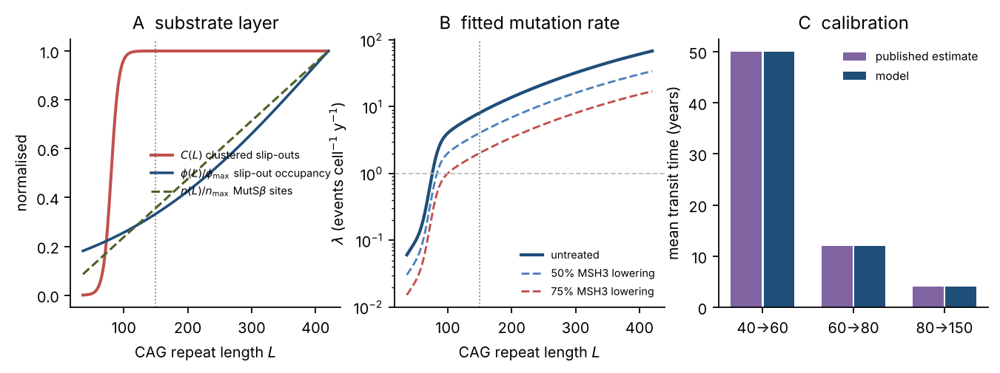

**Figure 1. The fitted expansion rate law.** (A) The three length-dependent terms plotted separately. The clustered fraction C(L) switches sharply near eighty repeats; occupancy φ(L) and site multiplicity n(L) grow slowly and almost linearly. The dotted line marks the 150-repeat commitment threshold. (B) Fitted λ(L) on a log scale, with the effect of 50% and 75% MSH3 lowering. (C) Model against published mean transit times.

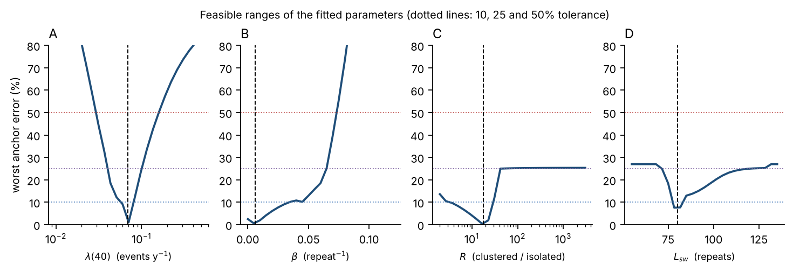

**Figure 11. What the data actually pin down.** (A to D) Each panel holds one fitted parameter at a fixed value, refits the other three, and plots the worst relative deviation from the four kinetic anchors. Flat regions are directions the data cannot see. λ(40) and L_sw sit in sharp wells; β is flat across four orders of magnitude; R has a broad floor with a soft lower edge. (E) The switch width w_sw is an assumed input rather than a fitted parameter, so it is scanned differently: it is held at each value and all four parameters are refitted. Shading marks the widths that still meet the 10% tolerance, with the darker band the widths at which the fit is still exact. The switch position moves with the assumed width, so the two should be read together.

### 3.2 The productive MutSβ species is not a cooperative assembly

If an expansion event needed a tandem assembly of k MutSβ molecules sitting on the same tract, then halving MSH3 would cut the rate by a factor of 2^k, not 2. That is a sharp, testable difference, and there is published data that bears on it.

The argument rests on two measurements, so they come first. At 25% residual MSH3 the measured prevention of striatal expansion is 78.1%; a first-order species predicts 75.0% and a tandem trimer predicts 98.4%. At 59% residual MSH3 the measured prevention is 45.1% against 41.0% for first order. Both points sit close to the first-order line and both are far from the cubic one, and that is the whole of the direct evidence.

Stated as the worst error on either measured point, the non-circular version of the statistic, that is 4.1 percentage points for k = 1, 9.6 for k = 1.5, 20.1 for k = 2 and 34.4 for k = 3 (`results/model_comparison_msh3.csv`).

Scoring the candidate orders instead by root mean square error against the published regression gives 4.97% for k = 1, 18.02% for k = 2 and 26.43% for k = 3 (Figure 2), which looks like a more decisive margin and is not. The comparator is a straight line fitted through those same two points, only k = 1 is itself a straight line in *m*, and nineteen of the twenty-one comparison levels are regression values where no measurement exists, all weighted equally. The test asks which curve is most like a line and offers one line, so the margin it reports is partly an artefact of its own construction. It is reported because it is the conventional comparison and because it is at least consistent, not because it settles anything.

What the two real points can carry is a narrower claim than exact first-order behaviour, and that is the claim made here: the dose-response excludes a strongly cooperative productive species. A trimer would have to leave 98% of expansion prevented at the lower dose and it leaves 78%. The two points do prefer k = 1 over k = 1.5, by 4.1 against 9.6 percentage points of worst error, but a regression with R² = 0.65 behind them does not make that margin conclusive, and nothing in this paper depends on it: at the achievable knockdown levels the two orders predict suppression within a few points of each other. The claim carried forward is the one the data support, which is that the productive species is not a cooperative assembly.

This needs to be stated carefully, because it sits in apparent tension with the cryo-EM proposal that the roughly forty-repeat pathogenic threshold is where three or more MutSβ molecules can first bind at once [3]. The two accounts are reconcilable, and the reconciliation is specific: tandem binding may set which substrates are competent, while the rate-limiting productive step still involves a single MutSβ and MutLγ complex acting at one of those sites. Occupancy and catalysis are different questions, and the data here speak to the second.

The practical consequence cuts both ways. There is no cooperative threshold to clear, so even modest MSH3 lowering buys proportional suppression from the first percent. But there is also no cooperative bonus, so near-complete suppression needs near-complete lowering. Everything in the delivery and trial analysis below follows from that one fact.

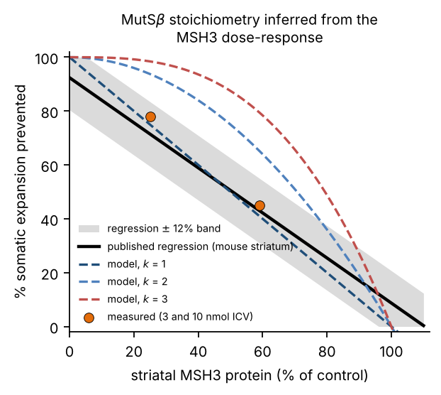

**Figure 2. Inferring MutSβ stoichiometry from the MSH3 dose-response.** The published regression (black) with the two measured intracerebroventricular doses (orange), against model predictions for k = 1, 2 and 3 simultaneously required MutSβ molecules.

### 3.3 Two held-out observations are matched cleanly, and the three misses are each informative

Simulating 20,000 independent projection neurons carrying 42 repeats, with no parameter tuned to any of the quantities below (`results/population_validation.csv`; the result table carries six rows rather than five, because the terminal-length comparison is written out as two statistics, its median and its 97.5th percentile, testing the centre and the tail of one distribution):

| Held-out observation | Published | Model |
|---|---|---|
| Neurons expanding beyond the inherited length | 95 to 98% | 99.9% |
| Fraction of neuronal life spent between 42 and 150 repeats | 96.4% (SD 2.0) | 97.5% |
| Time from 150 repeats to elimination | months, not decades | 20 months (median) |
| Terminal tract lengths | 100 to over 500, maximum 842 | median 236, 97.5th percentile 375 |
| Neuron loss at CAP = 600 | 80 to 99% | **43.5%** |

Two rows match cleanly, the second and the third. Of the remaining three, one overshoots, one matches its centre but not its tail, and one fails outright, and all three are worth looking at rather than rounding up.

The first row is the overshoot, and the prose should not call it a pass: the model has 99.9% of neurons expanding beyond their inherited length where 95 to 98% is reported, which is outside the published range even though it is in the right place qualitatively. The cause is the same conservative choice of step distribution discussed in section 2.2, in a different guise. With no mechanism in the model that holds a tract completely static over decades, essentially every neuron eventually gains at least one repeat, whereas a real population evidently contains a small fraction that does not. Two to five percent of neurons being somehow protected is a real observation and the model does not reproduce it. It does not affect anything downstream, since those neurons are a few percent of a population whose fate is decided by the ones that do expand, but it is a miss rather than a match.

The terminal length distribution is the partial match. Its centre is right, with a median of 236 repeats sitting inside the observed 100 to over 500, but its upper tail stops at 375 where lengths beyond 500 are reported. That is expected and has a known cause, since the simulation caps tract length at 1,000 repeats and uses a step size that does not grow with length. A length-dependent step would stretch the tail without changing anything upstream, and it was tried and discarded during calibration because it made the kinetic fit worse rather than better.

The last row is the outright failure and the serious one, and section 3.4 and section 3.5 are about chasing it down rather than explaining it away.

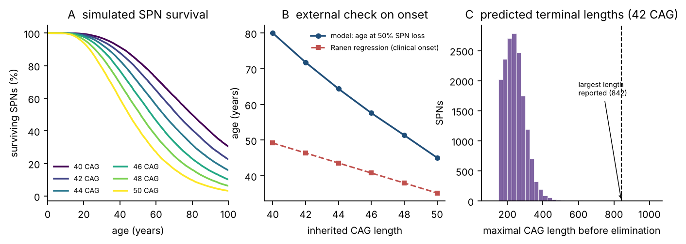

**Figure 3. Simulated neuron populations.** (A) Survival curves by inherited CAG length. (B) Model age at 50% loss against an external clinical regression. (C) Distribution of terminal tract lengths for a 42-repeat allele.

### 3.4 Accelerating neuron death does not close the gap

Donors with CAP scores above 600 are reported to have lost 80 to 99% of their projection neurons [1]. The model loses 43%. That is not a small discrepancy and it deserves a real attempt at explanation.

The obvious candidate is that striatal degeneration is not purely cell-autonomous, and that losing neurons makes the survivors more vulnerable. The network is losing inhibitory tone, trophic support and glutamate buffering as it thins, so a late avalanche is biologically plausible. This was tested directly, by multiplying every survivor's elimination hazard by (1 + k_nca · f_lost) and scanning the coupling constant from zero to forty.

It does essentially nothing. Mean loss at CAP 600 moves from 43.3% to 45.8% across the entire range (Figure 4B; `results/knca_fit.csv`), and the reported range is never reached at any value. Pushing the coupling higher does not help either, because the mechanism is saturating against a hard structural constraint.

The reason is the clearest mechanistic statement this model makes. Once a neuron crosses 150 repeats it is dead within about twenty months. The time spent waiting to reach that threshold is 97.5% of its life. Anything that acts after threshold is operating on the last 2.5% of the timeline, so it has almost no leverage on when the striatum is lost. Multiply the terminal hazard by forty and you shorten twenty months to a few weeks, which is invisible against five decades of waiting.

The same arithmetic applies to therapy, and that is why the delivery analysis matters as much as it does. There is no late rescue available in this model, for pathology or for treatment. Everything happens before the threshold or not at all.

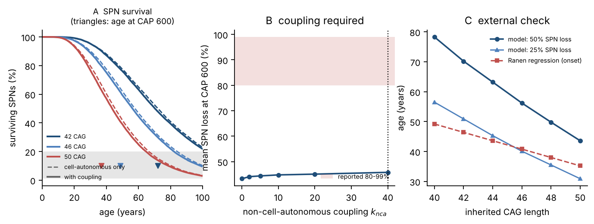

**Figure 4. Testing non-cell-autonomous acceleration.** (A) Survival with (solid) and without (dashed) coupling; triangles mark the age at CAP 600. (B) Mean neuron loss at CAP 600 against the coupling constant, with the reported range shaded. It is never reached. (C) Model ages at 25% and 50% loss against the external onset regression.

### 3.5 What would close the gap, and why the slower model is kept anyway

Two structural possibilities remain. Either the tract commits a neuron to death at a shorter length than 150 repeats, or expansion is uniformly faster than the published dwell times imply. A two-dimensional scan over both settles which of them could work (Figure 5A; `results/reconciliation_map.csv`).

Lowering the commitment length from 150 to 90 repeats moves end-stage loss only from 43.9% to 48.6%, so that is not the answer. A uniform rate multiplier g moves it from 43.9% at g = 1 to 90.8% at g = 2, so that is. Fitting the multiplier gives g = 1.96, which would imply transit times of 25.5, 6.1 and 2.0 years in place of the published 50, 12 and 4.

The trouble is that the faster model then fails an entirely different test, one that was not used to build either version. Under g = 1.96 a 42-repeat carrier reaches 50% neuron loss at age 36.9, and has lost 70.7% of projection neurons by the age an external clinical regression predicts for motor onset, 46.4 years [10]. For a 50-repeat carrier the figure is 81.9%. Losing four-fifths of the striatum before the first clinical sign is not credible, and it also contradicts the observation in the source paper that even at 25% loss more than nine out of ten surviving neurons still carry a tract that is not yet harmful [1].

One input to that regression is assumed and should be named here rather than left in a supplementary file, because it sits behind both of this section's conclusions and behind the falsifiable prediction in section 4.3. The regression takes a parental age at onset as well as a CAG length, and the source reports no cohort mean for it, so 45 years is assumed. Its influence is modest and bounded. The coefficient on parental onset is 0.3293, so moving the assumption across 35 to 55 years moves predicted onset for a 42-repeat carrier from 43.1 to 49.7 years, and the dwell-time-faithful model's loss at that age from 15.0% to 22.3% (`results/parent_aao_sensitivity.csv`). Over the same range the faster model's loss at onset stays between 64.4% and 75.7% at 42 repeats, and never falls below 64% at any length, so no plausible choice of parental onset age rescues it. The rejection of the faster model does not depend on the assumption. The width of the 18 to 31% prediction does, and section 4.3 says so.

The dwell-time-faithful model puts loss at predicted clinical onset at 18.4% for 42 repeats, 24.4% for 46 and 31.2% for 50. Those numbers are consistent with the single-cell picture and with the general finding that striatal atrophy on imaging precedes diagnosis by years rather than decades.

So the resolution adopted here is that "CAP above 600" in the source describes a late-stage, severely affected autopsy population rather than the threshold value CAP = 600 at which the model was evaluated. Post-mortem series are not sampled uniformly along the CAP axis; they are enriched for people who died of advanced disease. Evaluating the model at the stated threshold is the strictest possible reading of the published sentence, and a more generous reading dissolves much of the discrepancy.

There is a third candidate, and unlike the first two it is a defect in this work rather than in the data. Calibration minimises residuals on the mean-field transit-time integral, which follows the mean trajectory of the tract. The published anchors are mean first-passage times of a jump process. For a nonlinear λ those are different quantities, and the integral additionally ignores contractions, so there is no reason for them to agree and they do not. Compared directly at the fitted parameters (`results/transit_time_check.csv`), the stochastic process takes 65.3 years to cross from 40 to 60 repeats where the integral says 50, 18.0 years against 12, and 4.9 years against 4. The gap is 21 to 50%, of which about three quarters is the jump process itself and the remainder is contraction. So the model as fitted is slower than the published kinetics, in exactly the direction that would under-predict end-stage loss.

That is a testable proposition rather than a hand-wave, because the fit can simply be redone against the right quantity. Refitting the same four parameters against stochastic mean first-passage times instead of the integral converges cleanly (`results/estimator_calibration.csv`) and moves the parameters in an informative pattern: the basal rate rises by a third, from λ(40) = 0.070 to 0.092 per year, and R rises from 17.7 to 24.3, while the switch position barely moves at all, from 80.2 to 80.0 repeats, and β stays pinned at the bottom of its range. The structural conclusions of section 3.1 are therefore not artefacts of the estimator. The switch is still at eighty repeats and the thermodynamic term is still unidentifiable.

What does move is the quantity this section is about. Under the stochastic calibration, mean loss at CAP 600 rises from 39.8% to 62.4%, which closes rather more than half the distance to the reported 80 to 99% with no ad hoc rate multiplier anywhere. Both figures in that comparison are averages over the **three** inherited lengths carried through the estimator comparison, 42, 46 and 50 repeats, with the same seeds. The 43.5% quoted in section 3.3 is the same quantity averaged over the **six** lengths of `results/cap600_check.csv`, 40 to 50 repeats in steps of two, where the shortest length contributes the largest loss (65.1% at 40 repeats, because CAP 600 is reached at age 94.6) and raises the mean. The two are different averages of the same model, neither supersedes the other, and they are labelled here rather than reconciled. The cost is the same cost that sank M2, only smaller: loss at the externally predicted onset age rises from 18.7% to 36.1% for a 42-repeat carrier and from 30.6% to 52.1% at 50 repeats, which is high but not the four-fifths-of-the-striatum-gone that made M2 untenable. And the therapeutic conclusion is almost unchanged, which is the result that matters most here: the benefit of the measured achievable knockdown started at 30 is 13.7 points of striatum preserved at 70 under the mean-field fit and 14.7 under the stochastic fit (`results/estimator_predictions.csv`).

The mean-field parameterisation is kept as primary for one reason only, and it is a reason about provenance rather than about mathematics. It reproduces the published anchors exactly as those anchors are stated, and the source does not say which estimator its own numbers represent, so adopting the stochastic fit would mean assuming an answer to a question the literature does not settle. Carrying both and reporting the spread is the defensible position. The practical consequence is that the CAP-600 discrepancy is smaller than section 3.4 makes it look, that part of it is attributable to a choice of estimator rather than to biology, and that the conclusions this paper actually draws survive either choice.

This is also an unresolved tension in the published literature rather than only a modelling artefact, and it is worth being plain about that. The dwell-time-faithful model is used for every therapeutic prediction in this paper and the faster one is carried as a sensitivity bound. The tension is also testable: the two versions predict visibly different loss-versus-CAP trajectories (Figure 9B), and a post-mortem series with enough cases spread across the CAP range would separate them without needing any new technique.

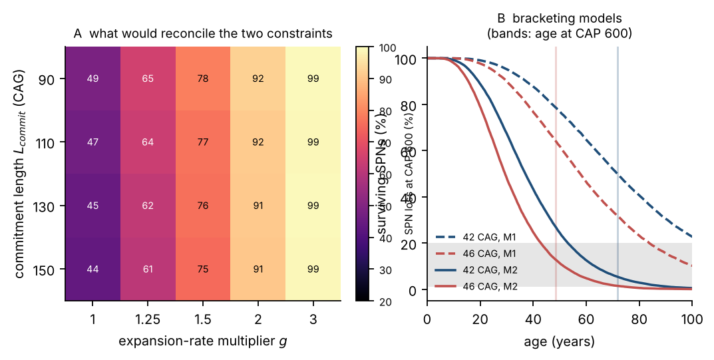

**Figure 5. Reconciling two published constraints.** (A) Mean neuron loss at CAP 600 across expansion-rate multipliers and commitment lengths. Only a roughly two-fold faster clock reaches the reported range. (B) Survival under the two bracketing parameterisations.

### 3.6 A held-out prediction: which neurons go first, and by how much

Indirect-pathway projection neurons are reported to expand about 15% faster than direct-pathway neurons, and to make up a smaller share of survivors in Huntington's disease donors than in controls, where they are 47% with a standard deviation of 6 [1]. Neither number was used in calibration, so running the two subtypes as separate populations with a 1.15 rate ratio produces a prediction with nothing fitted to it.

The prediction is that the depletion is real, orderly, and modest (Figure 12; `results/subtype_trajectory.csv`). For a 42-repeat carrier the indirect-pathway share of survivors falls from 47% to 45.9% by the time 10% of neurons are gone, to 44.2% at 25% loss, to 41.1% at 50% loss and to 36.3% at 75% loss. The same figures come out for 46 and 50 repeats within a few tenths of a point, which is a useful result in itself: **subtype depletion tracks total neuron loss, not age and not inherited CAG length.** It is a readout of disease stage rather than of genotype.

Two things follow. First, a depletion of five or six percentage points at half loss is small against a control standard deviation of six, so a cross-sectional study would need a lot of donors and careful staging to see it. The model says the effect is there but says it is not easy to measure, and that is a more useful statement than a bare direction.

Second, the inverse scan puts bounds on the rate difference (Figure 12C; `results/subtype_rate_scan.csv`). A ratio of 1.00 gives a depletion of −0.2 points, which is the Monte Carlo noise floor. The reported 1.15 gives 6.0 points at half loss. Reaching twenty points, the sort of difference that would be unmistakable in autopsy tissue, would need a ratio of about 1.6, which is well outside what the sequencing data support. So if a future series reports a large indirect-pathway depletion, a 15% rate difference will not account for it, and something besides expansion rate, such as a genuine difference in vulnerability per repeat, would have to be invoked.

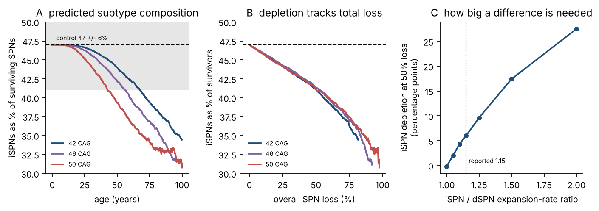

**Figure 12. Predicted subtype composition.** (A) Indirect-pathway neurons as a percentage of survivors over age, for three inherited lengths, against the control value of 47% with its measured spread shaded. (B) The same curves plotted against total neuron loss: they collapse onto one line, so depletion reports stage rather than genotype. (C) Depletion at half loss against the assumed rate ratio, with the reported value marked.

### 3.7 Genetic modifiers land on three different parameters, and only one of them is druggable

The strongest known modifiers of age at onset in Huntington's disease sit in mismatch-repair genes and in the sequence of the CAG tract itself. Each maps onto a distinct parameter of the fitted rate law, which means the model can convert a genotype into a predicted shift in years without any new fitting (Figure 13; `results/modifier_effects.csv`). Baseline for a 42-repeat carrier is age 51.8 at 25% neuron loss.

**MSH3 expression** enters as the first-order factor θ. Dropping it to 60% of normal, roughly what a protective expression quantitative trait locus might do, delays 25% loss by 33.6 years. Raising it to 150% brings the same endpoint forward by 16.6 years. The curve is steep and strongly asymmetric: the first 10% of lowering buys 5.6 years, the next 10% buys another 6.3, and the slope keeps rising. That asymmetry is the compounding effect, and it is the reason partial knockdown is worth more than it looks.

**FAN1 activity** enters as the protective divisor f. Halving it advances onset by 25.9 years, and doubling it delays onset by 51.5 years. FAN1 is numerically the strongest single lever in the model, which fits its position as one of the strongest onset modifiers in human genetics, and it fits the recent demonstration that FAN1 opposes MutLγ directly at the incision step [5]. It is also, unfortunately, the hardest to use: increasing an enzyme's activity in a deep brain structure is a much harder pharmacological problem than reducing a protein's abundance.

**Loss of a CAA interruption** enters as a downward shift in the clustering switch L_sw, because an uninterrupted tract reaches the clustered regime at a shorter total length than an interrupted one of the same nominal size. Shifting the switch down by ten repeats advances 25% loss by 16.8 years, and by fifteen repeats advances it by 24.2 years. This gives a quantitative mechanism for an observation that is otherwise hard to rationalise, namely that two carriers with identical nominal CAG counts can differ by a decade or more in onset depending on whether the tract is pure.

All three of these are predictions rather than fits. No modifier effect size entered the calibration, and the model was never shown a single human onset age.

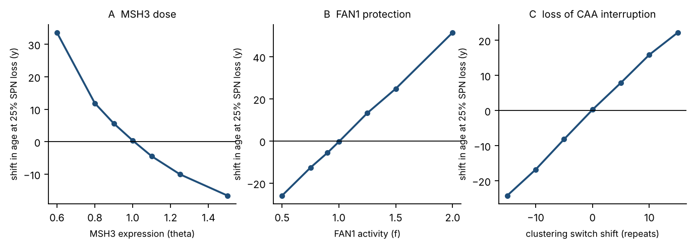

**Figure 13. Genetic modifiers as perturbations of one rate law.** Shift in age at 25% neuron loss for a 42-repeat carrier when (A) MSH3 expression, (B) FAN1 activity, or (C) the clustering switch position is perturbed. Zero on each vertical axis is the unperturbed baseline.

### 3.8 Delivery: the striatum is the wrong place to reach from cerebrospinal fluid

Converting the measured primate target engagement through the fitted exposure-response relationship (Figure 6A) gives what an intrathecal oligonucleotide actually achieves in the structure that matters:

| Region | Target knockdown measured in primate | Implied exposure | Predicted expansion suppression if MSH3 behaves the same |
|---|---|---|---|
| Putamen, projection neurons | 29% | 4.8 nmol per g | **33%** |
| Putamen, bulk tissue | 25% | 4.1 nmol per g | 30% |
| Caudate, single-nucleus RNA sequencing | 43% | 8.0 nmol per g | 45% |
| Caudate, quantitative PCR | 55% | 11.9 nmol per g | 55% |

Three cautions belong with that table, and the first is the heaviest. The primate measurement is not an MSH3 measurement. The study used an oligonucleotide against *Malat1*, a nuclear long non-coding RNA, as a reporter of where an intrathecally delivered gapmer is active, and it reports residual target RNA rather than residual protein [7]. The numbers are used here as a property of the route and the cell type, which is what they were measured to establish, and MSH3 is assumed to respond the same way to the same chemistry in the same neurons. That assumption is conventional, it is the best available, and it is the load-bearing step in the whole delivery argument, so no reader should be left to infer it. The right-hand column is labelled accordingly: it is what the model predicts if the assumption holds, not a measured suppression of expansion. These figures come from 25 mg given intrathecally three times in macaques, a regimen the original authors themselves note likely exceeds what clinical dosing would deliver [7]. And the inferred tissue penetration length is 3.9 mm, which is short against the depth of the human putamen.

How much worse the human case is depends entirely on how deep the human putamen is taken to be, and that single assumed number swings the answer by more than an order of magnitude, so it is reported as a range rather than as a figure (`results/depth_attenuation.csv`). Against the 10 mm assumed for the macaque, a human depth of 12 mm costs a further 1.7-fold, 16 mm costs 4.6-fold and 20 mm costs 12.9-fold. Scaling linear dimensions by the cube root of brain mass, from a roughly 90 g macaque brain to a roughly 1,300 g human one, gives 24.4 mm and a 40-fold penalty, but that is almost certainly too pessimistic: the putamen does not sit at a fixed fraction of brain radius, and in a human the lateral ventricle runs alongside it. The middle anatomical scenario, a 4.6-fold further attenuation at 16 mm, is the figure carried forward, and it should be read as the midpoint of a two to forty-fold range rather than as a result.

What is not in doubt is the direction and the reason for it. A diffusion-limited route into a deep structure gets worse, not better, when the brain gets bigger, and with a penetration length of 3.9 mm every additional four millimetres of depth costs roughly another factor of e.

So the honest summary is that the best measured intrathecal engagement in the right cell type in the right structure is 29%, that figure comes from a heavier-than-clinical regimen in a smaller brain, and the model says it corresponds to roughly a third of the available expansion suppression.

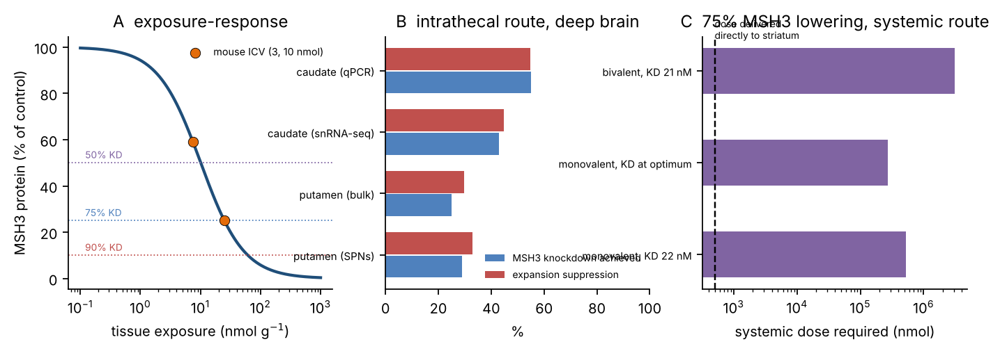

**Figure 6. The delivery problem.** (A) Exposure-response fitted to the two mouse intracerebroventricular doses, with target knockdown levels marked. (B) What intrathecal delivery achieves in deep brain and the expansion suppression it implies. (C) Systemic dose required for 75% MSH3 lowering, against the dose that actually needs to arrive in the striatum (dashed).

### 3.9 A systemic nanocarrier has an affinity optimum, and the optimum is not enough

Fitting the two-step capture and release model to the published anti-transferrin-receptor gold nanoparticle affinity series gives K_D,b = 286 nM for luminal capture and K_r = 64 nM for abluminal release, so parenchymal accumulation peaks at K_D of about 135 nM (Figure 7A). That is an order of magnitude weaker than the high-affinity variants that are usually engineered. Valency matters more than affinity over the measured range: the ratio of monovalent to bivalent accumulation at matched affinity is 5.7-fold, which is read straight off the measurements rather than fitted.

The same caution that applies to the exposure-response curve applies here, and for the same reason. Two parameters were fitted to two bivalent data points, so the curve passes through both by construction and the fit has nothing left over to be tested against. That means the existence of an interior optimum is a property of the assumed product form, not something these data demonstrate: any two points can be threaded by a capture-times-release curve, and such a curve always has a maximum. What the data do supply is where that maximum sits if the form is right, and the fact that accumulation falls between 21 and 149 nM, which at least establishes that tighter binding is not monotonically better over the measured range. The mechanism itself, that binding tighter captures more carrier at the luminal face and releases less of it on the far side, is taken from the transcytosis literature rather than derived here.

The optimum is real and it is small. Moving from the best measured monovalent design, at 0.230% of injected dose per gram, to the modelled optimum gives 2.0-fold more drug in the parenchyma. Set against the dose requirement, that is not close to sufficient (`results/translation.csv`):

| Design | Dose for 75% striatal MSH3 lowering | Improvement needed against 3 mg per kg |
|---|---|---|
| Bivalent, K_D 21 nM | 625 mg per kg | 208-fold |
| Monovalent, K_D 22 nM (best measured) | 109 mg per kg | 36-fold |
| Monovalent, at the modelled optimum | 54 mg per kg | 18-fold |

Every figure in that table is in milligrams, so it carries an assumed molecular weight, and since the paper quotes these numbers more than any others the assumption belongs next to them rather than in a result file. The model works in nanomoles; converting to mass needs a molecular weight, taken here as 14 kDa, roughly a divalent siRNA. The script sweeps 7, 14 and 28 kDa, which covers a single strand through to a heavily conjugated construct, and every milligram figure scales in direct proportion, so the quoted doses halve or double at the ends of that range. The fold improvements do not, because the 3 mg per kg ceiling they are measured against is itself a mass.

The contrast that makes the point is this. Seven milligrams of oligonucleotide inside a 20 g human striatum would achieve 75% MSH3 lowering, taking 14 kDa for the payload. Reaching that by the systemic transcytosis route would require injecting 7.6 grams. Affinity and valency engineering closes a factor of two of that gap. The rest has to come from somewhere else, and the arithmetic says exactly where to look: endosomal escape, assumed here at 2%, scales the required dose linearly and is by far the least constrained number in the chain. Receptor choice is the next lever. Failing both, the systemic route is the wrong route, and intraparenchymal or convection-enhanced delivery becomes the comparison to beat.

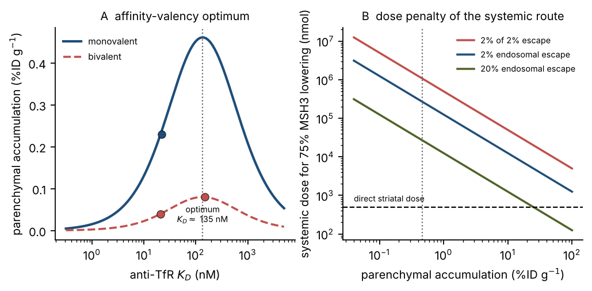

**Figure 7. Nanocarrier design space.** (A) Fitted affinity and valency response against the measured gold nanoparticle data, with the optimum at K_D of about 135 nM. (B) Systemic dose required for 75% MSH3 lowering as a function of parenchymal accumulation, for three endosomal escape fractions.

### 3.10 In silico trial: a real benefit, sublinear in dose, and dominated by timing

For a 42-repeat carrier, 47.3% of projection neurons are lost by age 70 without treatment. With lifelong treatment starting at age 30 (Figure 8A; `results/trial_grid.csv`):

| Striatal MSH3 knockdown | Neuron loss at 70 | Delay to 25% loss |
|---|---|---|
| 0% (control arm) | 47.2% | −0.4 y (Monte Carlo noise) |
| **29% (measured, putaminal neurons)** | **33.6%** | **8.2 y** |
| 43% (caudate, sequencing) | 26.2% | 15.7 y |
| 55% (caudate, PCR) | 21.1% | 25.0 y |
| 75% (aspirational) | 12.6% | over 57.5 y (censored) |
| 95% | 6.6% | over 57.5 y (censored) |

The zero-knockdown arm is there deliberately. It should show no effect, and it shows −0.4 years, which calibrates the Monte Carlo noise on these endpoints at roughly one year. The two censored rows are not predictions of a 57-year delay. They mean the simulated cohort never reaches 25% loss within a 110-year lifespan, and the number is a lower bound forced by where the simulation stops.

Three features of this table matter clinically.

**Timing dominates everything.** The same 29% knockdown delays 25% loss by 12.6 years if started at age 20, 8.2 years at 30, 3.8 years at 40 and 0.0 years at 50 (Figure 9A). Loss at 70 still falls from 47.3% to 40.0% in the age-50 arm, so the drug is doing something, but the clinically meaningful endpoint has already gone past. This is section 3.4 in therapeutic clothing: the drug acts only on the pre-threshold clock, and by age 50 a substantial share of neurons have already committed and cannot be recalled.

**A longer inherited allele compresses the window.** The same intervention from age 30 delays 25% loss by 10.8 years at 40 repeats, 8.6 at 42, 4.8 at 45 and 2.9 at 48 (`results/trial_scenarios.csv`; the independently seeded grid run above gives 8.2 rather than 8.6 at 42 repeats, which is a fair indication of the Monte Carlo spread). This is an awkward result for trial design. The carriers most likely to be enrolled, because they convert soonest and give an answer fastest, are the carriers for whom partial MSH3 lowering helps least.

**Returns rise steeply with knockdown.** Going from 29% to 55% roughly triples the delay. Going to 75% pushes the cohort past the end of the simulated lifespan. The cause is compounding: the clock is slowed every year for decades, so the benefit multiplies rather than adds. The therapeutic value of closing the last part of the delivery gap is much larger than the size of the gap suggests, and that is an argument for continuing to engineer delivery rather than settling for what intrathecal dosing currently reaches.

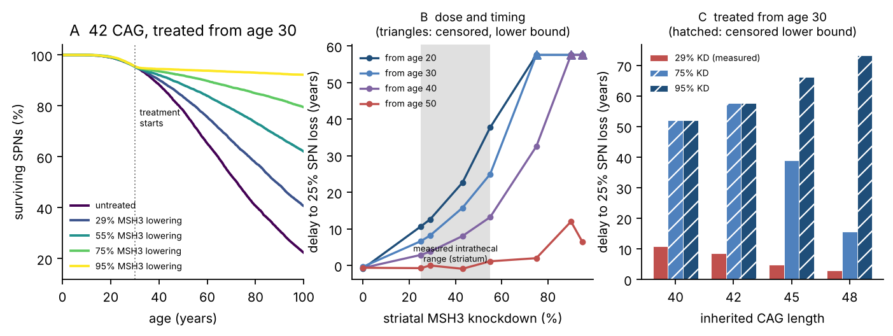

**Figure 8. In silico trial.** (A) Neuron survival for a 42-repeat carrier treated from age 30. (B) Delay to 25% loss against knockdown and start age; the shaded band is the measured intrathecal range and triangles mark censored lower bounds. (C) Dependence on inherited CAG length.

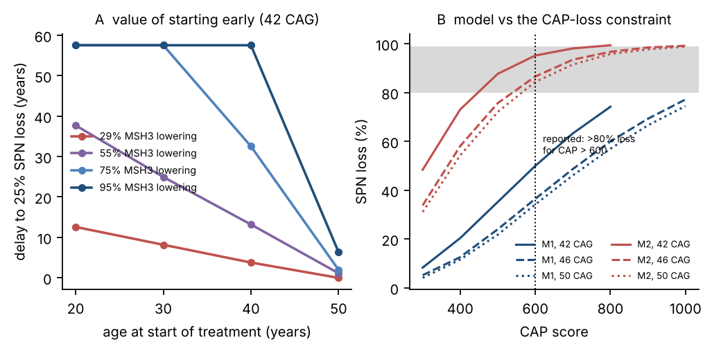

**Figure 9. Timing, and the outstanding constraint.** (A) Benefit against age at treatment start. (B) Neuron loss against CAP score for both bracketing models, with the reported end-stage range shaded.

### 3.11 From an idealised step to a real dosing schedule

The trial above assumes treatment sets striatal MSH3 to a new level instantly and holds it there for life. No real regimen does that. An intrathecal oligonucleotide is given as repeated boluses that decay between doses, so achieved knockdown oscillates between a peak and a trough.

Because the rate law is first-order in MSH3 (section 3.2), this correction is exact rather than approximate, with the conditionality set out in section 2.10: the data constrain the order to the neighbourhood of one rather than to one precisely, and at an order of 1.2 the shortcut would understate the cost of a peaky schedule. If the order is exactly one, the cumulative effect over decades depends only on the time-averaged MSH3 level and not on the shape of the waveform, so computing the time average over one steady-state dosing cycle and feeding it back as an effective residual gives the right lifetime answer. If the rate law had been cooperative, the peaks would have counted for more than the troughs and no such reduction would have been available. This is a case where a structural result from one part of the analysis buys exactness in another.

Neither the central-nervous-system half-life of a stabilised oligonucleotide nor the eventual dosing interval is settled, so both were swept rather than assumed (Figure 14B; `results/dosing_timeaverage.csv`). With a per-dose exposure chosen to give 75% peak knockdown, the time-averaged knockdown ranges from 13.7% in the worst case tested (one-month half-life, annual dosing) to 96.2% in the best (twelve-month half-life, three-monthly dosing). The structure of that grid is simple and useful: what matters is the ratio of half-life to interval, and once the half-life exceeds the interval, accumulation carries the trough up and the average approaches the peak.

Running representative schedules back through the lifetime model, for a 42-repeat carrier treated from age 30 against 48.3% untreated loss at age 70 (`results/dosing_benefit.csv`; this script seeds its populations independently of the grid in section 3.10, which gives 47.3% for the same untreated carrier, so the one-point difference is Monte Carlo spread rather than a change of model):

| Regimen | Effective knockdown | Loss at 70 | Benefit |
|---|---|---|---|
| Idealised step, 75% lowering | 75.0% | 13.2% | 35.2 points |
| Six-monthly, six-month half-life | 81.8% | 10.6% | 37.7 points |
| Six-monthly, three-month half-life | 64.0% | 16.9% | 31.4 points |
| Twelve-monthly, three-month half-life | 39.8% | 28.2% | 20.1 points |
| Four-monthly, nine-month half-life | 92.6% | 7.9% | 40.4 points |

The first row is the idealisation and the rest are what a schedule would actually deliver. Two of them beat the idealisation, which looks odd until you notice why: accumulation across doses lifts the steady-state peak above the single-dose peak, so a long half-life with frequent dosing ends up averaging better than a flat 75%. The row that should worry a trial designer is the third from bottom. Annual dosing with a three-month half-life loses 15 of the 35 available percentage points, not because the drug is weaker but because the patient spends most of the year near baseline. **The dosing interval is a therapeutic variable of the same order as the dose itself**, and it is one that can be optimised without any new chemistry.

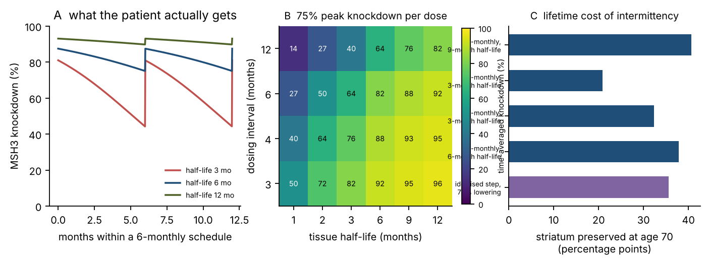

**Figure 14. What an intermittent schedule actually delivers.** (A) Achieved knockdown through one steady-state cycle of six-monthly dosing, for three tissue half-lives. (B) Time-averaged knockdown across half-life and interval, at 75% peak knockdown per dose. (C) Lifetime benefit for representative schedules against the idealised step change.

### 3.12 Could a trial of plausible size and length see the effect?

A predicted benefit is only useful if it is detectable. Converting the lifetime model into a conventional sample-size calculation, with the endpoint being change in projection-neuron survival over the trial period (the quantity striatal volume on MRI stands in for), gives the following for a cohort enrolled at age 40 with an imaging measurement standard deviation of 2 percentage points (Figure 15; `results/trial_power.csv`):

| Arm | 2-year trial | 3-year trial | 5-year trial |
|---|---|---|---|
| 29% knockdown (measured achievable) | 417 per arm | 133 per arm | 47 per arm |
| 55% knockdown (best caudate figure) | 150 per arm | 47 per arm | 14 per arm |
| 75% knockdown (aspirational) | 86 per arm | 28 per arm | 9 per arm |

The headline is that this is a feasible trial. At the knockdown that has actually been measured, a three-year study with 133 participants per arm has 80% power, and that is well within the range of trials that have been run in this disease. The effect size is small in absolute terms, 1.02 percentage points of striatum over three years, but the between-subject variability from the spread of inherited CAG lengths is also small, 0.86 points, so the signal-to-noise ratio is workable.

What dominates the sample size is not biology but imaging precision. Holding everything else fixed and sweeping the measurement standard deviation from 0 to 4 points moves the required sample size from 12 to 498 per arm, a forty-fold range (Figure 15C). The biological effect is the same in every one of those cases. **Measurement error is the binding constraint on trial size, not the strength of the drug effect**, and improving the reproducibility of the imaging endpoint is worth as much as improving target engagement.

Trial duration is the next strongest lever, and it works better than it should. Going from two years to five years cuts the required sample size by roughly nine-fold, far more than the three-fold that a proportional effect would give, because the effect grows faster than linearly with time while the measurement noise does not grow at all. A longer trial is cheaper per unit of statistical power.

The enrolment-age result is less clean and worth flagging as a caution. Enrolling at 50 rather than 40 makes the shorter trials harder, not easier: the required sample size rises from 417 to 523 at two years and from 133 to 165 at three, because the treatment effect itself is smaller in the older cohort (0.89 against 1.02 percentage points at three years). At five years the ordering reverses and 45 participants per arm suffice against 47, and the reason is variance rather than effect size. The between-subject spread contributed by the inherited CAG distribution falls from 1.33 to 0.72 points over a five-year window when enrolment is at 50, because by that age the faster-expanding carriers have already lost the neurons that would have separated them from the slower ones, so the cohort is more homogeneous in what remains to be lost. That is a real statistical effect and it is also a trap. A five-year trial enrolling at 50 is marginally easier to power and, per section 3.10, treats people for whom the clinically meaningful endpoint has mostly already passed. Optimising enrolment age for statistical convenience would select against therapeutic benefit, which is precisely the kind of mistake a model like this is useful for catching before it is made.

One source of between-subject variation is missing from all of these numbers and it is worth quantifying rather than only confessing. The spread above comes from the enrolled CAG distribution and from imaging noise; real participants also differ in the modifier genotypes of section 3.7, which this simulation does not sample. That variance adds in quadrature to the standard deviation in the sample-size formula, so its cost can be read off without re-simulating anything (`results/modifier_variance_power.csv`): an extra between-subject standard deviation of one percentage point over the three-year window raises the achievable-dose requirement from 133 to 148 per arm, and two points raises it to 193. The sample sizes quoted here are therefore floors in a second sense, on top of the dropout point made in the limitations.

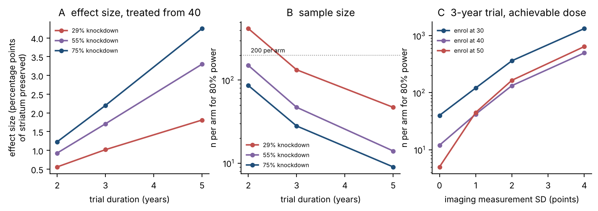

**Figure 15. Trial feasibility.** (A) Effect size against trial duration for three knockdown levels, treated from age 40. (B) Required sample size per arm for 80% power. (C) Sample size against imaging measurement error for a three-year trial at the achievable dose, for three enrolment ages.

### 3.13 The sign of the conclusion survives the uncertainty that was propagated

Across 160 Latin hypercube samples, with the rate law recalibrated inside every single sample so that calibration uncertainty is propagated rather than frozen at the central fit (Figure 10; `results/sensitivity_prcc.csv`), the benefit of the measured achievable knockdown of 29% starting at age 30 has a median of 11.5 percentage points of striatum preserved at age 70, and the central 95% of samples fall between 7.4 and 17.5 points. Untreated loss at 70 ranges from 20.6% to 54.9% and treated loss from 11.4% to 41.3%, **but the benefit is positive in every one of the 160 samples.** That last clause is the result of this section, and it is a stronger statement than the interval, for reasons worth being explicit about.

What that 7.4-to-17.5 range is, and is not, needs stating plainly. The sixteen inputs listed in section 2.13 and Table 1 are drawn **uniformly and independently** over ranges chosen by judgement, so the spread of the output is a sensitivity range conditional on those ranges. It is not a confidence interval and not a credible interval: there is no likelihood here and no prior, and calling it a "95% interval" would imply a probability statement the sampling design does not license. The result files record it as `p2.5` and `p97.5`, which is the honest label, and this paper uses the same language throughout. Nor does the range cover *all* parameter uncertainty: the delivery and translation constants (brain and striatum mass, putaminal depth, body weight, plasma volume, and the EC₅₀ and Hill coefficient of the exposure-response curve) are not in this ensemble. They are varied separately and one at a time, in sections 3.8, 3.9 and 3.14, and section 2.1 says why.

One further caveat belongs here because no reviewer should have to find it. The three dwell-time anchors are sampled independently although all three come from the same study on the same post-mortem cohort, so a systematic error in that study's clock would move all three together and could not cancel the way independent sampling allows. Section 3.15 measures what that assumption costs.

The strongest drivers are the pharmacodynamic order, with a partial rank correlation of +0.70, the contraction rate at −0.66, the expansion step size at −0.66 and the basal transit time at −0.54. It is reassuring that the top driver is the pharmacodynamic order, because that is the quantity most directly constrained by independent data (section 3.2) rather than the one most freely assumed.

It is less reassuring that three of the six strongest drivers are assumed rather than measured, and the point should be made in the prose and not left to the colours in Figure 10B. The contraction rate at −0.66, the switch width at −0.45 and the contraction step size at −0.42 are all values this work chose, they occupy the second, fifth and sixth places in the ranking, and all three sit well above every elimination constant. Their presence near the top is the main reason the sampled range of the benefit is as wide as 7.4 to 17.5 points. The reassuring version of this observation is that all three act in the same direction and that the benefit stays positive across the whole sampled range; the honest version is that the central estimate of 11.5 points would move if better measurements of somatic contraction became available, and contraction in human projection neurons is measured hardly at all.

The reassurance that can be given is narrower and applies to the elimination submodel specifically. The three constants that set how a neuron dies once it passes the threshold have partial rank correlations of −0.15, +0.14 and −0.11, all below the weakest of the drivers above, which is the quantitative form of the argument in section 3.4: what happens after the threshold has almost no leverage on when the striatum is lost. The numerical ceiling on tract length, swept here from 600 to 1,400 repeats, comes out at +0.09 and is likewise immaterial to the benefit, which confirms that the narrow terminal tail in section 3.3 is a presentational limit rather than something the therapeutic conclusion depends on. The MutSβ footprint has a correlation of essentially zero, for a structural reason worth stating: it enters the rate law multiplicatively through site multiplicity, and calibration absorbs any change in it into the pre-factor A, so it cannot affect the outcome. A parameter taken from a preprint turns out to be immaterial, which is a better position to be in than relying on it.

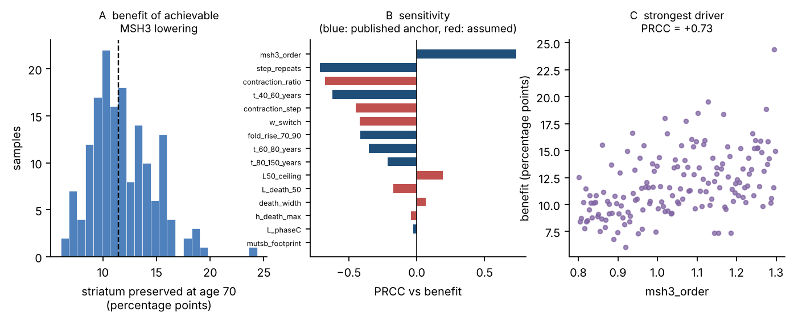

**Figure 10. Global sensitivity.** (A) Distribution of the predicted benefit across 160 recalibrated samples. (B) Partial rank correlation of each input against benefit; blue inputs are published anchors, red are assumed constants. (C) Response to the strongest driver.

### 3.14 How much do two mouse doses constrain the delivery arithmetic?

Everything in sections 3.8 to 3.11 passes through one exposure-response curve with two free parameters fitted to exactly two published mouse doses. Two parameters on two points is an exact interpolation with no residual to minimise, so the fitted Hill coefficient of 1.215 is not a measurement of cooperativity: it is whatever value makes the curve pass through both points. Limitation 5 says so. What it does not say is how much that matters, and the question is answerable with the same profile logic used on the rate law in section 3.1.

Fixing the Hill coefficient at each of a grid of values and refitting EC₅₀ through the two measured points gives the answer (Figure 17A; `results/hill_profile.csv`). The two doses turn out to constrain the curve better than the zero degrees of freedom suggest: at the same 10% tolerance used for the rate-law profiles, the admissible Hill window is **1.05 to 1.35**, with EC₅₀ moving only from 9.85 to 10.26 nmol g⁻¹. The reason is geometric rather than lucky: the two doses sit at 7.5 and 25 nmol g⁻¹, which straddle the fitted EC₅₀, so between them they pin both the position of the curve and its steepness.

Propagating that window through the numbers the paper actually quotes (`results/exposure_response_band.csv`):

| Quantity | Point estimate | Across the admissible Hill window |
|---|---|---|
| Striatal exposure for 50% MSH3 knockdown | 10.1 nmol g⁻¹ | 9.9 to 10.3 |
| Striatal exposure for 75% knockdown | 25.0 nmol g⁻¹ | **23.1 to 28.1** |
| Striatal dose for 75% knockdown, at 14 kDa | 7.0 mg | **6.5 to 7.8 mg** |
| Striatal exposure for 90% knockdown | 61.7 nmol g⁻¹ | 52.2 to 79.9 |

The band widens with distance from the calibrated range, exactly as it should: −3 to +1% at 50% knockdown, which sits inside the two measured doses, −7 to +12% at 75% knockdown just outside them, and −15 to +29% at 90% knockdown, well beyond. For scale, a Hill coefficient of 0.5 misses a measured point by 41% and one of 3.0 by 83%, so the window is narrow because the data are informative about steepness, not because the grid was drawn tightly. Because the required systemic dose is strictly proportional to the required striatal exposure, the same relative band carries to the reported shortfall: the 18 to 36-fold figure of section 3.9 becomes **17 to 40-fold**.

That is the honest result, and it is more favourable to the paper than Limitation 5 implies. The curve's two-point construction is a real weakness of the underlying data and it would matter a great deal if the analysis depended on the far tail of the curve. For the headline requirement of about 25 nmol g⁻¹ and 7 mg it does not: the figure is uncertain by roughly a tenth, not by an order of magnitude, and no conclusion in sections 3.8 to 3.11 turns on a tenth. The dosing analysis in section 3.11 is the exception to flag, since its grid reaches steady-state peaks of up to 388 nmol g⁻¹, fifteen times the highest calibration point and far outside the window tested here; those rows should be read as showing the *shape* of the half-life-to-interval trade-off rather than as calibrated exposures.

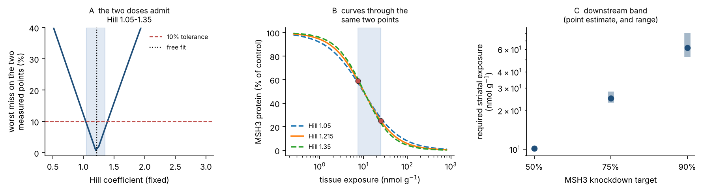

**Figure 17. What two doses pin down.** (A) Worst miss on the two measured points as the Hill coefficient is held at each value and EC₅₀ refitted; shading marks the window meeting the 10% tolerance and the dotted line the free two-point fit. (B) The curves at the free fit and at both edges of the window, with the calibrated exposure range shaded. (C) Required striatal exposure at three knockdown targets: point estimate and the range across the window, on a log scale. The band widens with extrapolation distance.

### 3.15 Correlated calibration anchors widen the loss predictions but not the benefit

The sensitivity analysis of section 3.13 samples the three dwell-time anchors independently, although all three come from one study on one post-mortem cohort. If that study's clock is systematically fast or slow, all three move together, and independent sampling lets such an error cancel across the ensemble in a way reality would not. Repeating the whole analysis with the three anchors coupled through a Gaussian copula at latent correlations of 0, 0.5 and 0.9 settles what that costs (Figure 16; `results/anchor_correlation.csv`). The realised rank correlations among the coupled anchors are −0.05, +0.42 and +0.86 against copula targets of 0, +0.48 and +0.89, so the dependence is being imposed as intended.

| Outcome | ρ = 0 | ρ = 0.5 | ρ = 0.9 |
|---|---|---|---|
| Untreated loss at 70, central 95% | 19.8 to 56.7 | 18.8 to 63.4 | 18.0 to 66.7 |
| Untreated loss, width | 36.9 | 44.6 | **48.7** |
| Benefit, median | 11.48 | 11.43 | 11.45 |
| Benefit, central 95% | 6.4 to 21.2 | 6.2 to 19.8 | 6.1 to 20.8 |
| Benefit, width | 14.8 | 13.6 | 14.7 |
| Benefit, minimum across samples | 3.0 | 3.3 | 2.8 |
| Benefit positive in all 160 samples | yes | yes | yes |

The two halves of that table behave differently, and the reason is worth stating because it is the same reason the paper's therapeutic claim is more robust than its epidemiological ones. Correlating the anchors widens the spread of **absolute** loss substantially, since a common-mode error in the clock moves the whole trajectory: the central 95% range for untreated loss at 70 grows by a third, from 36.9 to 48.7 percentage points. It leaves the **benefit** essentially untouched: the median moves by 0.05 points across the whole range of coupling, the width does not trend, and the benefit stays positive in every sample at every correlation. The benefit is a difference between two arms simulated with the same sampled parameters and the same seeds, so a systematic error in the clock largely cancels in that difference while surviving in each arm separately.

One further comparison belongs here, because it cuts against the paper rather than for it. The ρ = 0 arm of this analysis is the same model and the same ranges as section 3.13, differing only in sampler: copula draws rather than a Latin hypercube. Its median agrees to two decimal places, 11.48 in both, which is the check that the implementation is sound. But its central 95% range is 6.4 to 21.2 points against 7.4 to 17.5 from the Latin hypercube, about 45% wider. Latin hypercube sampling stratifies each margin and so reduces the variance of the ensemble, which means **part of the narrowness of the interval reported in section 3.13 is a property of the sampler rather than of the model.** The wider figure is the more conservative one. Neither is a probability statement, for the reasons given in section 3.13, and the claim that does not depend on the choice is the one to carry: across 640 recalibrated samples drawn four different ways, the benefit of achievable MSH3 lowering was positive in every single one.

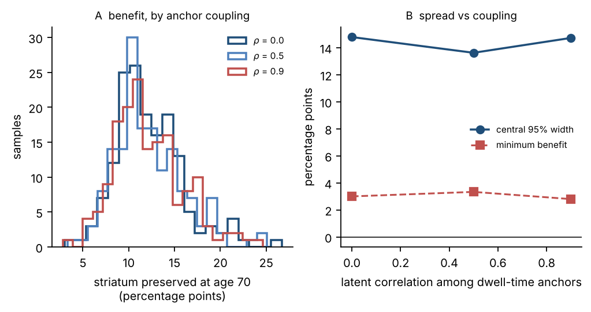

**Figure 16. Coupling the calibration anchors.** (A) Distribution of the predicted benefit at three strengths of correlation among the three dwell-time anchors. (B) Central 95% width and minimum of the benefit against latent correlation. The spread does not trend and the minimum stays well above zero.

---

## 4. Discussion

### 4.1 What the model says

Somatic CAG expansion in this model behaves as a switch rather than a ramp, and the switch sits at roughly eighty repeats, close to the length at which a tract can first host clustered slip-outs that mismatch repair is known to resolve badly. The position of that switch is one of the best-determined quantities in the fit once its width is fixed, and somewhere between about 75 and 99 repeats when the two are read jointly, while the thermodynamic parameter that a more conventional model would have leaned on is not determined at all.

MSH3 lowering acts on the process with an order the data place at or near one, so suppression tracks target engagement close to proportionally. There is no cooperative threshold to clear and no cooperative bonus to collect. Because a neuron that crosses 150 repeats dies within about twenty months, and because reaching 150 takes 97.5% of its life, essentially all therapeutic leverage lies in the pre-threshold decades and essentially none afterwards. That single structural fact explains why accelerating terminal death cannot reconcile the model with end-stage autopsy data, and it explains why treatment started at 50 does so much less than treatment started at 30.

The arithmetic that follows is uncomfortable. The striatal MSH3 lowering that cerebrospinal-fluid-delivered oligonucleotides currently achieve in primates, 25 to 55% from a regimen heavier than clinical dosing and likely worse in a brain four times larger, yields a third to a half of the available suppression and preserves 13.7 percentage points of striatum by age 70 at the central fit, or a median of 11.5 points across the recalibrated ensemble of section 3.13. That is a genuine disease-modifying effect, and section 3.12 says a trial of ordinary size would see it. But it is a small fraction of what the target can deliver, since 75% knockdown pushes the same cohort past the end of a simulated lifespan.

### 4.2 An engineering specification, written in numbers

The point of building a model like this is that it turns a biological ambition into figures a formulation or device team can work against.

1. **Target engagement of at least 70% reduction in MSH3 protein in putaminal projection neurons.** Not in cerebrospinal fluid, not in cortex, and not in bulk striatal tissue. Bulk measurement underestimates what is needed, because projection neurons are the cells that expand and they are a minority of the tissue.
2. **Begin before age 30**, and earlier for carriers above 45 repeats. The delay to 25% loss falls steeply with each decade of delay, from 12.6 years when treatment begins at 20 to 8.2 at 30, 3.8 at 40 and nothing at 50. Striatum preserved at age 70 erodes more gently over the same range, 17.9 to 13.7 to 9.7 to 7.3 percentage points, so late treatment is not useless, it simply stops moving the endpoint that matters clinically.
3. **Required tissue exposure of about 25 nmol per gram**, which is about 7 mg inside a 20 g human striatum at an assumed molecular weight of 14 kDa, and 3.5 to 14 mg across the 7 to 28 kDa range swept.
4. **Dose at an interval no longer than the tissue half-life.** Annual dosing with a three-month half-life throws away 15 of the 35 available percentage points of benefit. This costs nothing to fix and is the cheapest improvement available anywhere in this analysis.
5. **A systemic transcytosis route needs an 18 to 36-fold improvement** in parenchymal delivery over the best measured transferrin-receptor design, or 17 to 40-fold once the uncertainty in the exposure-response curve is carried through (section 3.14). Affinity and valency optimisation, to monovalent binding at K_D near 135 nM, supplies about two-fold of that. Endosomal escape is the dominant remaining term and the most promising place to engineer.
6. **The trial endpoint must be striatal MSH3 protein**, or a validated surrogate such as a somatic expansion index in a reachable compartment. Cerebrospinal fluid drug concentration is not sufficient, because the entire difficulty is the step from cerebrospinal fluid to putamen, and a concentration measured upstream of the hard step says nothing about whether the hard step happened.
7. **Invest in imaging reproducibility alongside target engagement.** A reduction in endpoint measurement error from 4 to 2 percentage points cuts the required sample size nearly four-fold, which is a larger effect than doubling target engagement.

### 4.3 Predictions that could falsify this

- Clinical motor onset should correspond to 18 to 31% projection-neuron loss, rising with inherited CAG length. Much more than that and the dwell-time-faithful model is wrong. Two caveats travel with this number and neither is small. The onset ages it is read against come from a regression that needs a parental age at onset, assumed here to be 45 years, and moving that assumption across 35 to 55 years moves the range from 15 to 24% at the low end to 22 to 38% at the high end (section 3.5). And under the alternative calibration of section 3.5 the same prediction becomes 36 to 52%, so a post-mortem series reporting half the striatum gone at diagnosis would not falsify the model, it would select between two parameterisations of it. What would falsify the model is loss substantially above that, or no relationship between loss and CAP score at all.
- The relationship between CAP score and neuron loss should follow the trajectory in Figure 9B. A well-powered post-mortem series spread across the CAP range would discriminate the two bracketing models immediately, and would resolve the one genuine inconsistency in this work.
- Because the productive MutSβ species is not a cooperative assembly, partial MSH3 lowering should suppress somatic expansion in human striatal neurons with no cooperative threshold to clear: a 50% reduction in MSH3 should buy roughly half the available suppression, not a quarter or an eighth. This is directly testable in patient-derived striatal cultures, where antisense-mediated MSH3 suppression has already been shown to reduce expansion [11]; what has not been done is a dose titration fine enough to separate a first-order dependence from a mildly cooperative one. That titration is the single most informative experiment this model points to, because the therapeutic argument rests on it and because the two measured mouse doses can only exclude strong cooperativity, not pin the order.
- Expansion rate should rise sharply rather than smoothly as tracts pass eighty repeats, and the rise should be **complete within about four to eight repeats**. That window is not a modelling choice but what the published dwell times require (section 3.1), and it is the most quantitative version of the switch claim available. A transition measurably more gradual than that would falsify the structure, not merely shift a parameter. The position should also shift with anything that alters slip-out spacing; CAA interruption is the obvious test case, and section 3.7 gives the predicted size of the shift in years.
- Indirect-pathway depletion should be about six percentage points at half neuron loss, should scale with total loss rather than with age or genotype, and should not exceed about ten points at any stage. A reported depletion much larger than that cannot be explained by a 15% rate difference.

### 4.4 Where this sits in the field

The demonstration that FAN1 opposes MutLγ directly [5] fits into this framework without strain, as a modifier of the escape probability R, which is precisely the parameter the model identifies as carrying the length dependence. That gives a mechanistic account of why FAN1 variants are among the strongest onset modifiers known, and section 3.7 quantifies it: FAN1 is the single strongest lever in the model and also the least tractable pharmacologically.

The model also implies that huntingtin-lowering and MSH3-lowering are not competitors but complements that act on different parts of the same timeline. MSH3 lowering extends the pre-threshold phase, during which a neuron is alive and not yet carrying a harmful tract. Huntingtin lowering can only address toxicity once a cell has crossed the threshold. On this reading a combination should be more than additive, since one arm delays arrival at the threshold and the other reduces the consequence of arriving, and nothing in this model makes them interfere.

Finally, there is a methodological point worth making. Every quantitative claim in this paper came from four published numbers fitted to a four-parameter law, and everything else, including five held-out validations, three modifier predictions, a subtype prediction and a trial power calculation, followed without further fitting. That the fit worked is no surprise, since four parameters against four targets should fit. What is worth noticing is how much the fitted structure went on to get right about data it was never shown, and that where it got things wrong, in the fraction of neurons that never expand, in the upper tail of terminal lengths and in end-stage loss, the failures pointed at specific assumptions rather than at the structure as a whole.

---

## 5. Limitations

1. **No primary data.** Every calibration target is a published summary statistic, and several of them are themselves model-derived. The transit times in [1] come from a simulation rather than from longitudinal measurement of single cells, so this model inherits the assumptions of that one.
2. **The functional form of the rate law is assumed.** Each factor in λ(L) is sourced, but writing them as a product is not: it assumes the steps are independent and sequential. The fit cannot test that assumption, because a different combination rule with its own four free parameters would very likely also reproduce four anchors. What the data constrain is the shape of the length dependence, not the algebra that produces it.
3. **A key biochemical source is a preprint.** The MutSβ footprint and stoichiometry [3] come from a bioRxiv preprint that has not been peer reviewed. The sensitivity analysis shows the footprint is immaterial, for the structural reason given in section 3.13, but the qualitative tandem-binding picture is not independently confirmed here.
4. **The discrepancy with end-stage autopsy data is only partly resolved**, and not explained away. Section 3.5 shows that refitting against the right transit-time estimator closes more than half of it, which leaves a smaller gap than the raw comparison in section 3.4 suggests but does not close it. The remainder is attributed to "CAP above 600" describing a late-stage autopsy population rather than a threshold, which is reasonable and is the least convenient reading for the author's own argument, but is not demonstrated.
5. **The exposure-response curve has zero degrees of freedom and is used outside its calibrated range.** Two parameters fitted to two mouse doses interpolate exactly, so the curve cannot be wrong on its own data and its Hill coefficient of 1.22 is a consequence of the fit rather than a measurement of cooperativity. The two points span 7.5 to 25 nmol g⁻¹ and the curve is applied from 4.1 to 388 nmol g⁻¹. Every number in the delivery and dosing analysis passes through it. Section 3.14 now quantifies what that costs rather than leaving it as a caution, and the answer is more reassuring than the construction suggests: because the two doses straddle the fitted EC₅₀, they constrain the Hill coefficient to 1.05 to 1.35 at a 10% tolerance, and the headline requirement of 25 nmol g⁻¹ moves only to 23.1 to 28.1 across that window. The limitation that remains is specifically about the top of the range: at 90% knockdown the band is −15 to +29%, and the dosing grid of section 3.11 reaches 388 nmol g⁻¹, fifteen times the highest calibration point and far outside anything the two doses can constrain. Those rows show the shape of the half-life-to-interval trade-off, not calibrated exposures. Figure 6A marks the calibrated interval and Figure 17 the admissible window.
6. **The primate engagement figures are not MSH3 and are not protein.** They are residual *Malat1* RNA from a reporter study of intrathecal oligonucleotide distribution [7], used as a property of the route and the cell type. Target equivalence and the substitution of residual RNA for residual protein are both assumed, and the second cannot be checked in the source because the target has no protein product.
7. **The midpoint of the length switch is conditional on its width.** The width w_sw was fixed at 6 repeats before fitting, so it began as an input. Section 3.1 profiles it and the anchors turn out to constrain it: an exact fit exists only between 4.0 and 7.5 repeats. That converts the sharpness from an assumption into a result, and it is reported as one. What remains conditional is the midpoint, because position and width move together: L_sw ranges from 76.4 to 85.3 repeats across the widths that fit, and from 74.6 to 101.6 across the full swept range. The specific figure of 80.2 repeats holds only at a width of exactly 6 and should not be quoted alone.
8. **Calibration fits a mean-field integral, and the stochastic process it stands for is 21 to 50% slower.** Section 3.5 refits against stochastic first-passage times and reports the consequences: the switch position and the therapeutic benefit barely move, end-stage loss rises substantially, and loss at predicted onset rises from 18 to 31% to 36 to 52%. Which estimator the published anchors represent is not recoverable from the source, so both parameterisations are carried. Readers who prefer the stochastic one should read every age in this paper as several years earlier and every end-stage loss figure as considerably higher.
9. **A small protected fraction of neurons is not reproduced.** The model expands essentially every neuron beyond its inherited length where 95 to 98% is reported, so whatever keeps a few percent of tracts static over decades is absent from it. Nothing downstream turns on those neurons, but it is a failed comparison and section 3.3 counts it as one.
10. **Species scaling is crude.** The macaque-to-human penetration correction uses cube-root geometric scaling and an assumed putaminal depth. The direction is robust, the magnitude is not, and a real answer would need a diffusion model on actual human anatomy.
11. **The pharmacodynamic link crosses species and timescales.** Proportionality between MSH3 protein and expansion suppression was measured in mouse striatum over three months and is assumed here to hold in human projection neurons over decades.
12. **Nanocarrier pharmacokinetics collapse into a single efficiency term.** Plasma clearance, protein corona formation, opsonisation, hepatic first pass, receptor saturation at therapeutic doses and chronic-dosing tolerability are all absent. Every one of them would make the systemic route harder rather than easier, so the stated dose requirement should be read as a lower bound.
13. **Endosomal escape at 2% is assumed**, and it scales the systemic dose requirement linearly. It is the least constrained number in the delivery analysis, which is why it is swept rather than asserted in Figure 7B.
14. **Neurons are independent** except in the explicit coupling test of section 3.4, and non-neuronal contributions are omitted entirely. Astrocytic glutamate handling, microglial activation and loss of corticostriatal input are all part of the real disease and none of them are here.
15. **Treatment is a step change in the main trial analysis.** Section 3.11 removes this for the first-order case, exactly rather than approximately, but the correction relies on first-order pharmacodynamics and would not transfer to a cooperative mechanism.
16. **Safety is not modelled at all.** Lifelong suppression of a mismatch-repair protein beginning in the third decade raises mutational and oncological questions this work does not address. MSH6 protein rose to 142% of control at the highest dose in the mouse study [4], suggesting compensatory shifts within the repair machinery whose long-term consequences are unknown. A specification that says "start before 30 and continue for life" is a specification with an unquantified risk attached, and no amount of modelling of efficacy substitutes for measuring that risk.
17. **No sequence-level design was attempted.** An oligonucleotide design module was planned and dropped, because the sequence databases needed to do it rigorously were unreachable from this environment and a sequence written from memory would have been unverifiable. Section 6 records what was blocked.
18. **The trial power calculation assumes a normal endpoint and no dropout.** Real trials lose participants, and a right-censored survival endpoint would need a different calculation. The sample sizes given should be read as a floor.
19. **The power calculation omits modifier-genotype variance.** Its between-subject spread comes only from the inherited CAG distribution and from imaging noise. Real cohorts also differ in the mismatch-repair and tract-structure modifiers of section 3.7, which move age at 25% loss by more years than the enrolled CAG range does. That variance enters the sample-size formula directly, and `results/modifier_variance_power.csv` shows its cost: an extra between-subject standard deviation of 1 point over a three-year trial raises the achievable-dose arm from 133 to 148 participants per arm, and 2 points raises it to 193. The headline numbers are therefore optimistic in a second, quantified way.
20. **The dosing model has no protein-turnover lag.** Section 3.11 converts a drug concentration waveform straight into an MSH3 waveform, so MSH3 is assumed to track tissue drug exposure instantaneously. Real protein recovery lags the fall of an oligonucleotide by its own turnover time, which smooths the troughs of an intermittent schedule. The direction is known: this omission makes infrequent dosing look worse than it is, so the penalties quoted for annual dosing are upper bounds.
21. **The transcytosis affinity optimum is fitted on two points.** The capture-times-release form in section 3.9 has two free constants and the mouse study provides two usable monovalent affinities [8], so the fit has no degrees of freedom left and cannot be tested against the data that produced it. The existence of an interior optimum follows from the functional form, which is mechanistically motivated but not independently validated; its position near 135 nM should be read as an illustration of where such an optimum would sit, not as a measured value.
22. **The reported sensitivity range is conditional on judgement-chosen ranges, and partly on the sampler.** The sixteen inputs of the global analysis are drawn uniformly and independently over ranges this work selected, so the 7.4-to-17.5-point spread in section 3.13 is a sensitivity range, not a confidence or credible interval; there is no likelihood and no prior behind it. Section 3.15 shows that a copula sampler over the identical model and ranges gives 6.4 to 21.2 points, about 45% wider, because Latin hypercube stratification reduces ensemble variance. The narrowness of the reported interval is therefore partly a property of how the space was sampled. The conclusion that does not depend on either choice is that the benefit was positive in all 640 samples across both analyses.

23. **The delivery and translation constants are not in the global ensemble.** Brain and striatum mass, putaminal depth, body weight, plasma volume, molecular weight, endosomal escape, and the EC₅₀ and Hill coefficient of the exposure-response curve are varied one at a time in dedicated scans rather than jointly with the expansion model. Section 2.1 gives the reason and section 3.14 profiles the exposure-response curve specifically, but no analysis here propagates delivery uncertainty and expansion uncertainty simultaneously, so the delivery numbers and the neuron-loss numbers carry separate error budgets that are never combined.

---

## 6. Reproducibility

```
code/hdmodel.py          core model: rate law, calibration, Gillespie and tau-leaping solvers
code/01_calibrate.py     calibration, identifiability, MutSbeta stoichiometry   -> Fig 1-2
code/02_population.py    population simulation, held-out validation             -> Fig 3
code/03_coupling.py      solver verification, non-cell-autonomous test          -> Fig 4
code/04_reconcile.py     reconciliation map, bracketing models                  -> Fig 5
code/05_delivery.py      exposure-response, CSF route, nanocarrier design space -> Fig 6-7
code/06_trial.py         in silico trial                                        -> Fig 8-9
code/07_sensitivity.py   Latin hypercube with recalibration, PRCC               -> Fig 10
code/08_translation.py   dose translation to mg/kg
code/10_profile.py       parameter profiles and feasible ranges                 -> Fig 11
code/11_subtypes.py      direct and indirect pathway prediction                 -> Fig 12
code/12_modifiers.py     genetic modifiers as parameter perturbations           -> Fig 13
code/13_dosing.py        intermittent dosing and time-averaged knockdown        -> Fig 14
code/14_trial_power.py   sample size and power for a real trial                 -> Fig 15
code/17_estimator.py     mean-field vs stochastic calibration (section 3.5)
code/18_anchor_correlation.py  correlated calibration anchors (section 3.15)   -> Fig 16
code/19_exposure_response_band.py  Hill profile and delivery band (3.14)       -> Fig 17
code/09_build_documents.py  builds the Word and PDF versions of this paper
code/15_build_ieee.py       builds the IEEE-format LaTeX and PDF
code/16_build_ieee_docx.py  builds the IEEE-format Word version
```

Run in numerical order from `code/`. Total runtime is about seventy minutes on a single core, most of it in the two sensitivity analyses, which between them recalibrate the model 640 times. Every random seed is fixed, so the figures and tables reproduce exactly. Every number quoted in this paper is written to `results/` as CSV or JSON by the script that produced it, and no number was transcribed by hand. Constants shared between scripts, such as the fitted EC₅₀ and Hill coefficient, are read from the result file that defines them rather than duplicated as literals, so re-running a fit cannot leave a stale value downstream.

The `review/` directory carries two dated internal audit passes and a resolution log, and they are part of the method rather than an appendix to it. For a sole-authored computational paper with no primary data, a documented adversarial re-reading is the substitute for the co-author who would otherwise catch things, and it is worth being specific about what it caught. The first pass worked outward from the structure of the model; the second traced every number in the paper back to the result table it came from and re-read every script for constants that had been copied rather than read. Between them they found two wrong numbers in the prose, one mechanism stated backwards, one claim that a verification had been performed when it had not, a set of load-bearing assumptions that were visible in the code but not in the text, and two places where a fitted constant had been hard-coded downstream. Three findings became new analysis rather than new wording, and one changed a conclusion: the discovery that the mean-field calibration estimator runs 21 to 50% slow prompted the stochastic refit of section 3.5, which closes most of the end-stage loss gap that sections 3.4 and 3.5 had been unable to explain. The sections of this paper that are most hedged are the ones that survived that process, and the hedging is the output of it.

Dependencies are Python 3.12 with NumPy, SciPy and Matplotlib. The document build additionally needs pandoc and LibreOffice.

**What could not be done from this environment.** The NCBI Entrez and Crossref programmatic interfaces were blocked by the network policy, PubMed Central required browser verification, and several publisher sites were unreachable or rate-limited. The practical consequences were two. First, the planned oligonucleotide sequence-design module was dropped rather than attempted from memory. Second, where a retrieved page did not expose a volume or page range, the reference below gives a DOI instead of a guessed citation. No reference appears here that was not opened and read.

---

## 7. References

1. Handsaker RE, Kashin S, Reed NM, et al. Long somatic DNA-repeat expansion drives neurodegeneration in Huntington's disease. *Cell.* 2025. PMID 39824182. Full text: https://mccarrolllab.org/wp-content/uploads/2025/01/handsaker_kashin_reed_et_al.cell_.2025.pdf

2. The breaking point where repeat expansion triggers neuronal collapse in Huntington's disease. *Cell Genomics.* 2025;5(4). https://www.cell.com/cell-genomics/fulltext/S2666-979X(25)00072-2 (commentary on reference 1)

3. Li J, Wang H, Yang W. Tandem MutSβ binding to long extruded DNA trinucleotide repeats underpins pathogenic expansions. *bioRxiv* 2023.12.12.571350. doi:10.1101/2023.12.12.571350. PMID 38168405. Preprint, not peer reviewed.

4. Dose-dependent reduction of somatic expansions but not Htt aggregates by di-valent siRNA-mediated silencing of MSH3 in HdhQ111 mice. *Scientific Reports.* 2024. doi:10.1038/s41598-024-52667-3

5. Senoussi I, Mengoli V, Cerana A, et al. Mechanism of trinucleotide repeat expansion by MutSβ and MutLγ and contraction by FAN1. *Nature Communications.* 2025;16:9445. doi:10.1038/s41467-025-64485-w

6. Panigrahi GB, et al. Isolated short CTG/CAG DNA slip-outs are repaired efficiently by hMutSβ, but clustered slip-outs are poorly repaired. *Proceedings of the National Academy of Sciences USA.* 2010. doi:10.1073/pnas.0909087107

7. Frei JA, Gentile JE, Lian Y, Mortberg MA, Capitanio J, Jafar-nejad P, Vallabh SM, Zhao HT, Minikel EV. Cell type distribution of intrathecal antisense oligonucleotide activity in deep brain regions of non-human primates. *Nucleic Acid Therapeutics.* 2025. doi:10.1177/21593337251371594

8. Johnsen KB, Bak M, Kempen PJ, Melander F, Burkhart A, Thomsen MS, Nielsen MS, Moos T, Andresen TL. Antibody affinity and valency impact brain uptake of transferrin receptor-targeted gold nanoparticles. *Theranostics.* 2018;8(12):3416 to 3436. doi:10.7150/thno.25228

9. O'Reilly D, et al. Di-valent siRNA-mediated silencing of MSH3 blocks somatic repeat expansion in mouse models of Huntington's disease. *Molecular Therapy.* 2023. https://www.cell.com/molecular-therapy-family/molecular-therapy/fulltext/S1525-0016(23)00262-9

10. Orth M, Schwenke C. Age-at-onset in Huntington disease. *PLOS Currents Huntington Disease.* 2011 Jul 29, Edition 1. doi:10.1371/currents.RRN1258

11. Antisense oligonucleotide-mediated MSH3 suppression reduces somatic CAG repeat expansion in Huntington's disease iPSC-derived striatal neurons. *Science Translational Medicine.* 2025. doi:10.1126/scitranslmed.adn4600

12. Enroll-HD. Special characteristics of HD data: CAP = age × (CAG − 33.66). https://enroll-hd.org/for-researchers/analyzing-data/special-characteristics-of-hd-data-2/ (citing Warner JH et al., Standardizing the CAP score in Huntington's disease)
